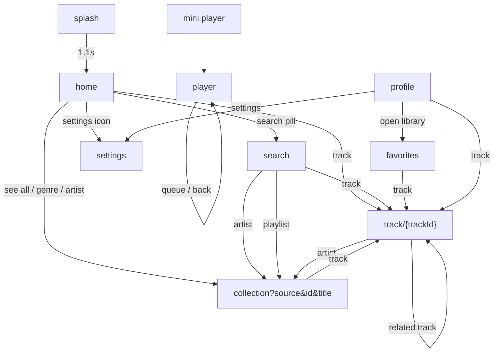
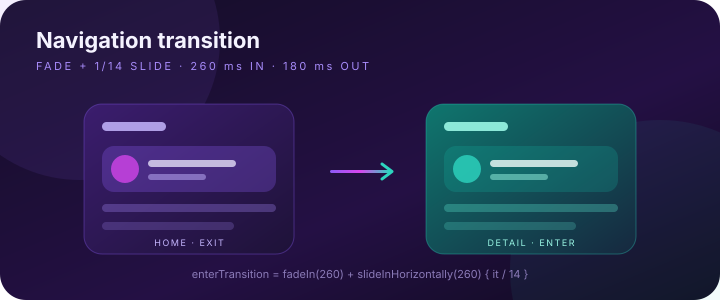
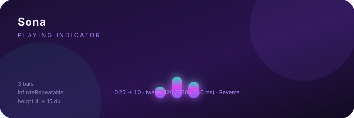
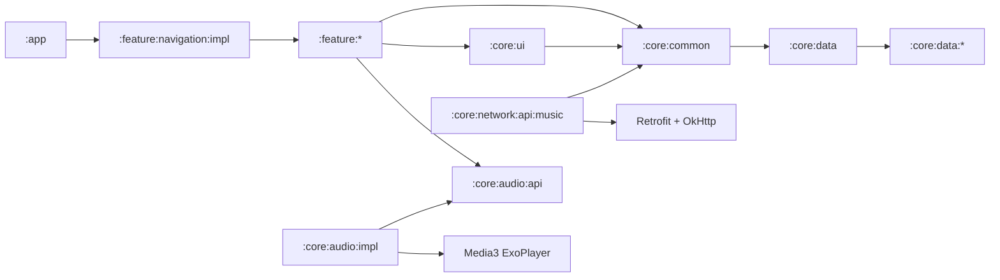

# Sona



<p align="left">
  
  
  
  
  
  
  
  
</p>

**Sona** — Android-плеер и стриминговый клиент открытой музыкальной сети **Audius**.
Полностью на Kotlin + Jetpack Compose: потоковое воспроизведение, поиск, лайки, плейлисты,
профиль, настройки, оффлайн-метаданные и живая информация об устройстве.

> **Статус:** собирается в debug и release без устройства. 74 модуля,
> 9 экранов, 4 доменных API, 28 модулей информации об устройстве,
> 10 unit-тестов (0 падений).

> Документация: [архитектура](docs/ARCHITECTURE.md) · [экраны](docs/SCREENS.md) ·
> [анимации](docs/ANIMATIONS.md) · [API](docs/API.md) · [модули](docs/MODULES.md) ·
> [DI](docs/DI.md) · [сборка](docs/BUILD.md) · [changelog](CHANGELOG.md)

---

## Содержание

- [Возможности](#возможности)
- [Экраны](#экраны)
- [Бренд и splash](#бренд-и-splash)
- [Навигация](#навигация)
- [Анимации](#анимации)
- [Архитектура](#архитектура)
- [Структура проекта](#структура-проекта)
- [Сеть и Audius API](#сеть-и-audius-api)
- [Dependency Injection](#dependency-injection)
- [UI-слой](#ui-слой)
- [Технологии](#технологии)
- [Сборка и запуск](#сборка-и-запуск)
- [Тесты](#тесты)
- [Версии и теги](#версии-и-теги)
- [Документация](#документация)
- [Ограничения](#ограничения)

---

## Возможности

| Блок | Что умеет |
|---|---|
| 🎧 Воспроизведение | ExoPlayer/Media3, очередь, shuffle, repeat (off/all/one), seek, foreground-service, медиа-уведомление |
| 🏠 Главная | тренды, «свежие» треки, артисты, жанровые фильтры, featured-карточка |
| 🔎 Поиск | треки / артисты / плейлисты, debounce, жанры, пустые и ошибочные состояния |
| ❤️ Библиотека | лайки, «недавно играло», общее время, play-all |
| 👤 Профиль | аккаунт Audius, подписчики, лайки, недавние, меню, «О приложении» |
| 📃 Коллекции | trending / genre / artist / playlist в одном экране |
| 🎵 Детали трека | обложка, артист, жанр/настроение, статистика, описание, похожие треки |
| ⚙️ Настройки | тема (system/light/dark), Audius-токен, очистка библиотеки, информация об устройстве |
| 📱 Информация об устройстве | 28 модулей: батарея, сеть, Wi-Fi, Bluetooth, датчики, память, приложения и т.д. |
| 🖼️ Бренд | один аватар `ic_sona_mark` на splash, в шапке Home и в adaptive-иконке запуска |
| 🎨 Дизайн | своя тема, градиенты, glass-элементы, mini-player, bottom bar |

---

## Экраны

| Экран | Route | Файл |
|---|---|---|
| Splash | `splash` | `feature/splashscreen/impl/.../SplashScreen.kt` |
| Home | `home` | `feature/home/impl/.../HomeScreen.kt` |
| Search | `search` | `feature/searchmusic/impl/.../SearchScreen.kt` |
| Favorites | `favorites` | `feature/favorites/impl/.../FavoritesScreen.kt` |
| Profile | `profile` | `feature/profile/impl/.../ProfileScreen.kt` |
| Track details | `track/{trackId}` | `feature/detailmusic/impl/.../DetailMusicScreen.kt` |
| Collection | `collection?source={source}&id={id}&title={title}` | `feature/musiclist/impl/.../MusicListScreen.kt` |
| Player | `player` | `feature/player/impl/.../PlayerScreen.kt` |
| Settings | `settings` | `feature/settings/impl/.../SettingsScreen.kt` |

Подробно про состояния, интенты и компоненты — в [docs/SCREENS.md](docs/SCREENS.md).

---

## Бренд и splash



Аватар приложения — один вектор `core/ui/src/main/res/drawable/ic_sona_mark.xml`:
фиолетово-розовый градиент с белой нотой. Он используется:

| Где | Как |
|---|---|
| Иконка запуска | `app/src/main/res/drawable/ic_launcher_background.xml` + `ic_launcher_foreground.xml` (adaptive icon) |
| Splash | `SplashBrand` → `SonaLogo(size = 108.dp)` |
| Home header | `SonaLogo(size = 42.dp)` |

Splash показывает аватар с пружинным входом (0.82 → 1.0, ~600 ms), затем
«дыханием» 1 → 1.045 → 1 (1.6 s) и пульсирующим свечением позади. Через
1.1 s приложение уходит на Home, splash удаляется из back stack.

Полный разбор таймингов и кода — [docs/ANIMATIONS.md](docs/ANIMATIONS.md#splash-и-аватар-приложения).

---

## Навигация



Правила навигации:

- **Top-level** (`home`, `search`, `favorites`, `profile`) — `popUpTo(home) { saveState = true }`,
  `launchSingleTop = true`, `restoreState = true` — вкладки не плодят стек.
- Splash удаляется из стека: `popUpTo(splash) { inclusive = true }`.
- Bottom bar и mini-player скрываются на `player` и `splash`.
- Аргументы `collection` кодируются через `URLEncoder` (`+` → `%20`).

---

## Анимации

Кратко, полный разбор — в [docs/ANIMATIONS.md](docs/ANIMATIONS.md).





| Анимация | Где | Параметры |
|---|---|---|
| Переходы между экранами | `SonaApp.kt` (`NavHost`) | `fadeIn 260ms` + `slideIn 1/14 ширины`; pop — зеркально |
| Кроссфейд обложек | `Artwork.kt` (Coil) | `crossfade(220ms)` |
| Эквалайзер playing | `PlayingIndicator` | 3 полосы, `0.25 → 1`, `tween(420/530/640ms)`, `Reverse` |
| Цвет выбранной вкладки | `SonaBottomBar` | `animateColorAsState` |
| Прогресс mini-player | `MiniPlayer` | `LinearProgressIndicator` |
| Bottom sheet очереди | `PlayerScreen` | `ModalBottomSheet` + `skipPartiallyExpanded` |
| Snackbar-сообщения | все route-экраны | стандартный `SnackbarHost` |
| Splash | `SplashScreen` | показ 1.1 c, затем переход |

---

## Архитектура



Слои:

1. **UI** — Compose-экраны + собственные компоненты фич, состояния через `StateFlow`.
2. **Presentation** — `*ViewModel` + `*UiState` + `*Intent` + `*Effect`, MVI-подход.
3. **Domain** — модели (`core/common/model`), контракты (`MusicRepository`), use cases.
4. **Data** — `MusicRepositoryImpl`, DataStore, device-info readers.
5. **DI** — Dagger 2: `AppComponent` + модули по слоям.

---

## Структура проекта

```text
Sona/
├── app/                          # Application, MainActivity, DI-граф, манифест
├── core/
│   ├── common/                   # модели, контракты, use cases, DataStore, утилиты
│   ├── ui/                       # общие Compose-компоненты, тема, форматтеры
│   ├── network/api/music/        # Audius: TrackApi, PlaylistApi, UserApi, SearchApi
│   ├── audio/api | impl/         # плеер, сервис, MediaSession
│   ├── data/                     # агрегатор device-info + 28 reader-модулей
│   ├── cache/ camera/ worker/    # заготовки инфраструктурных модулей
├── feature/
│   ├── navigation/               # NavHost, bottom bar, mini-player
│   ├── splashscreen/ home/ searchmusic/ favorites/ profile/
│   ├── detailmusic/ musiclist/ player/ settings/
│   └── comments/                 # заготовка
├── docs/                         # ARCHITECTURE, SCREENS, ANIMATIONS, API, MODULES, DI, BUILD
├── gradle/libs.versions.toml     # version catalog
└── settings.gradle.kts
```

Каждая фича разделена на `api` (routes/контракты) и `impl` (UI, ViewModel, DI).
Внутри `impl` — `presentation/` и `presentation/components/` для локальных UI-компонентов.

---

## Сеть и Audius API

База: `https://api.audius.co/v1/`, приложение `app_name=Sona`.

| Интерфейс | Ответственность | Примеры |
|---|---|---|
| `TrackApi` | треки, стриминг, лайки | `tracks/trending`, `tracks/{id}/stream`, `tracks/{id}/favorite` |
| `PlaylistApi` | плейлисты, альбомы | `playlists/search`, `playlists/{id}/tracks` |
| `UserApi` | аккаунт, артисты | `users/me`, `users/{id}/tracks`, `users/{id}/followers` |
| `SearchApi` | общий поиск | `search`, `search/full`, `search/autocomplete` |

Полный список эндпоинтов — [docs/API.md](docs/API.md) и
[`core/network/api/music/README.md`](core/network/api/music/README.md).

---

## Dependency Injection

```kotlin
@Module
object ApiModule {
    @Provides @Singleton
    fun provideTrackApi(retrofit: Retrofit): TrackApi = retrofit.create(TrackApi::class.java)

    @Provides @Singleton
    fun providePlaylistApi(retrofit: Retrofit): PlaylistApi = retrofit.create(PlaylistApi::class.java)

    @Provides @Singleton
    fun provideUserApi(retrofit: Retrofit): UserApi = retrofit.create(UserApi::class.java)

    @Provides @Singleton
    fun provideSearchApi(retrofit: Retrofit): SearchApi = retrofit.create(SearchApi::class.java)
}
```

`AppComponent` раздаёт API наружу:

```kotlin
component.trackApi()
component.playlistApi()
component.userApi()
component.searchApi()
```

А фича просит только то, что ей нужно:

```kotlin
@Inject constructor(
    private val trackApi: TrackApi,
    private val userApi: UserApi,
)
```

---

## UI-слой

**Общие компоненты** — `:core:ui`, пакет `com.sona.core.ui`:

- `component/`: `Artwork`, `TrackRow`, `TrackTile`, `ArtistRow`, `ArtistTile`, `PlaylistRow`,
  `PlayingIndicator`, `MiniPlayer`, `SonaBackground`, `SonaLogo`, `SonaChip`, `SectionHeader`,
  `EmptyState`, `ErrorState`, `LoadingState`, `GradientCircleButton`, `CircleIconButton`,
  `OutlinePill`, `StatPill`.
- `theme/`: цвета, типографика, формы, `SonaTheme`.
- `format/`: `formatDuration`, `formatCount`, `greetingForNow`.

**Компоненты фич** — `feature/*/impl/.../presentation/components/`:

| Фича | Компоненты |
|---|---|
| home | `HomeHeader`, `HomeSearchPill`, `FeaturedTrackCard` |
| searchmusic | `SearchField`, `BrowseGenres`, `GenreCard` |
| favorites | `FavoritesHero` |
| detailmusic | `TrackDetailHero` |
| musiclist | `CollectionHero` |
| profile | `ProfileHero`, `ProfileStat`, `ConnectAudiusCard`, `ProfileTracksRow`, `ProfileMenuItem` |
| settings | `SettingsSectionLabel`, `ThemeOption`, `SettingsActionRow`, `AboutRow`, `DeviceInfoCard` |
| player | `PlayerControls`, `QueueSheet` |
| navigation | `SonaBottomBar` |
| splashscreen | `SplashBrand` |

---

## Технологии

| Слой | Технология | Версия |
|---|---|---|
| Язык | Kotlin | 2.2.10 |
| UI | Jetpack Compose (BOM) | 2026.02.01 |
| Дизайн | Material 3 | BOM |
| Навигация | navigation-compose | 2.9.8 |
| DI | Dagger | 2.60.1 |
| Асинхронность | Coroutines / Flow | 1.10.2 |
| Сеть | Retrofit + OkHttp + Gson | 3.0.0 / 5.5.0 / 2.13.1 |
| Аудио | Media3 ExoPlayer + Session | 1.9.4 |
| Изображения | Coil | 2.7.0 |
| Хранение | DataStore Preferences | 1.1.7 |
| Сборка | AGP | 9.3.3 |
| SDK | compileSdk / minSdk | 37 / 24 |

---

## Сборка и запуск

```bash
# debug
./gradlew :app:assembleDebug

# release (unsigned)
./gradlew :app:assembleRelease

# все unit + androidTest исходники
./gradlew compileDebugUnitTestKotlin compileDebugAndroidTestKotlin
```

APK:

```text
app/build/outputs/apk/debug/app-debug.apk
app/build/outputs/apk/release/app-release-unsigned.apk
```

Требования и troubleshooting — [docs/BUILD.md](docs/BUILD.md).

---

## Тесты

Короткие unit-тесты на самые хрупкие чистые функции и мапперы — без Android,
эмулятора и сети.

| Файл | Что проверяет | Тестов |
|---|---|---|
| `core/ui/src/test/.../format/FormattersTest.kt` | `formatDuration` (минуты/часы), `formatCount` (K/M/B) | 2 |
| `core/network/api/music/src/test/.../mapper/AudiusMappersTest.kt` | маппинг `TrackDto` / `UserDto` / `PlaylistDto`, fallback'и, `streamUrl` | 6 |

```bash
# только эти тесты
./gradlew :core:ui:testDebugUnitTest :core:network:api:music:testDebugUnitTest

# все unit-тесты проекта
./gradlew testDebugUnitTest

# проверить, что тестовые исходники компилируются (без запуска)
./gradlew compileDebugUnitTestKotlin compileDebugAndroidTestKotlin
```

Результат на момент релиза:

```text
core:ui                          tests=3  failures=0
core:network:api:music           tests=7  failures=0
```

(в каждом модуле остался шаблонный `ExampleUnitTest`, поэтому всего 10 тестов;
8 из них — содержательные.)

Отчёт HTML: `core/ui/build/reports/tests/testDebugUnitTest/index.html` и
`core/network/api/music/build/reports/tests/testDebugUnitTest/index.html`.

---

## Версии и теги

| Тег | Что означает |
|---|---|
| `v1.0.0` | Первый полный релиз: все экраны, навигация, Audius API по доменам, общий `core/ui`, device-info |

```bash
git tag -n                 # список тегов
git show v1.0.0            # аннотация релиза
git checkout v1.0.0        # состояние релиза
```

История изменений — [CHANGELOG.md](CHANGELOG.md).

---

## Документация

| Документ | О чём |
|---|---|
| [docs/ARCHITECTURE.md](docs/ARCHITECTURE.md) | слои, потоки данных, DI, принятые решения |
| [docs/SCREENS.md](docs/SCREENS.md) | все экраны: состояния, интенты, эффекты, компоненты |
| [docs/ANIMATIONS.md](docs/ANIMATIONS.md) | переходы, тайминги, эквалайзер, как менять |
| [docs/API.md](docs/API.md) | Audius API по доменам, DTO, маппинг, стриминг |
| [docs/MODULES.md](docs/MODULES.md) | дерево модулей, правила зависимостей, рецепты |
| [docs/DI.md](docs/DI.md) | Dagger 2: компонент, модули, скоупы, ViewModel, ошибки KSP |
| [docs/BUILD.md](docs/BUILD.md) | требования, команды, APK, подпись, troubleshooting |
| [CHANGELOG.md](CHANGELOG.md) | история версий и проверок |

---

## Ограничения

- Audius API не проверялся вживую в CI (нет эмулятора/сети в окружении сборки).
- Release-APK не подписан: добавьте `signingConfigs` для публикации в стор.
- Часть инфраструктурных модулей (`cache`, `camera`, `comments`, `worker`) — заготовки.
- Токен Audius вводится вручную в настройках; OAuth-флоу пока нет.
