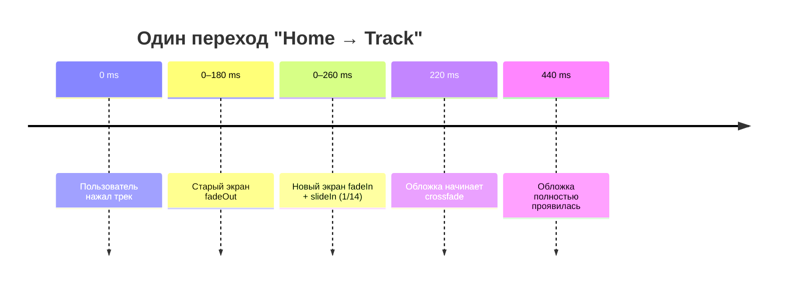

# Анимации Sona

В Sona анимации делятся на три уровня:

1. **Навигационные** — переходы между экранами (`NavHost`).
2. **Компонентные** — обложки, эквалайзер, bottom bar, прогресс, bottom sheet.
3. **Системные** — ripple, snackbar, диалоги, индикаторы Material 3.


---

## Содержание

- [Сводная таблица](#сводная-таблица)
- [Переходы между экранами](#переходы-между-экранами)
- [Кроссфейд обложек](#кроссфейд-обложек)
- [Эквалайзер PlayingIndicator](#эквалайзер-playingindicator)
- [Bottom bar](#bottom-bar)
- [Mini player](#mini-player)
- [Очередь воспроизведения](#очередь-воспроизведения)
- [Snackbar и диалоги](#snackbar-и-диалоги)
- [Splash и аватар приложения](#splash-и-аватар-приложения)
- [Тайминги](#тайминги)
- [Производительность](#производительность)
- [Как изменить анимации](#как-изменить-анимации)
- [Accessibility](#accessibility)

---

## Сводная таблица

| Анимация | Где | API | Длительность | Повтор |
|---|---|---|---|---|
| Вход экрана | `SonaApp.kt` → `NavHost.enterTransition` | `fadeIn` + `slideInHorizontally` | 260 ms | один раз |
| Выход экрана | `NavHost.exitTransition` | `fadeOut` | 180 ms | один раз |
| Возврат (вход) | `NavHost.popEnterTransition` | `fadeIn` + `slideInHorizontally(-1/14)` | 220 ms | один раз |
| Возврат (выход) | `NavHost.popExitTransition` | `fadeOut` + `slideOutHorizontally` | 180 / 220 ms | один раз |
| Кроссфейд обложки | `Artwork.kt` | Coil `crossfade` | 220 ms | на каждую загрузку |
| Эквалайзер | `PlayingIndicator` | `rememberInfiniteTransition` + `animateFloat` | 420 / 530 / 640 ms | бесконечно, `Reverse` |
| Цвет вкладки | `SonaBottomBar` | `animateColorAsState` | по умолчанию (~300 ms) | на смену вкладки |
| Прогресс mini-player | `MiniPlayer` | `LinearProgressIndicator` | обновляется из `PlayerState` | постоянно |
| Прогресс плеера | `PlayerScreen` | `Slider` + drag state | интерактивно | — |
| Очередь | `PlayerScreen` | `ModalBottomSheet` | системная | по открытию |
| Snackbar | все route-экраны | `SnackbarHost` | системная | по событию |
| Splash: вход аватара | `SplashBrand` | `animateFloatAsState` + `spring` | ~600 ms | один раз |
| Splash: дыхание аватара | `SplashBrand` | `rememberInfiniteTransition` | 1 600 ms | бесконечно, `Reverse` |
| Splash: свечение | `SplashBrand` | радиальный градиент + `graphicsLayer` | 1 600 ms | бесконечно, `Reverse` |
| Splash: таймер | `SplashScreen` | `delay` + переход | 1 100 ms | один раз |
| Загрузка | `LoadingState` / `CircularProgressIndicator` | Material 3 | бесконечно | пока грузится |

---

## Переходы между экранами

Файл: `feature/navigation/impl/src/main/java/com/sona/feature/navigation/impl/presentation/SonaApp.kt`

```kotlin
NavHost(
    navController = navController,
    startDestination = SplashDestination.ROUTE,
    modifier = Modifier.weight(1f),
    enterTransition = {
        fadeIn(animationSpec = tween(260)) +
            slideInHorizontally(animationSpec = tween(260)) { it / 14 }
    },
    exitTransition = { fadeOut(animationSpec = tween(180)) },
    popEnterTransition = {
        fadeIn(animationSpec = tween(220)) +
            slideInHorizontally(animationSpec = tween(220)) { -it / 14 }
    },
    popExitTransition = {
        fadeOut(animationSpec = tween(180)) +
            slideOutHorizontally(animationSpec = tween(220)) { it / 14 }
    },
) { /* destinations */ }
```

### Что это значит

| Переход | Эффект |
|---|---|
| Открытие нового экрана | новый экран проявляется и **въезжает справа** на 1/14 ширины; старый плавно исчезает |
| Нажатие «назад» | предыдущий экран проявляется и **въезжает слева**; текущий уезжает вправо и исчезает |
| Смена top-level вкладки | тот же лёгкий fade + slide, без полного сдвига на всю ширину |
| Splash → Home | стандартный `enterTransition`, splash удаляется из стека |

Смещение `it / 14` — это примерно **7 % ширины экрана**. Полный сдвиг на 100 %
выглядел бы как «карусель» и конфликтовал бы с bottom bar; 7 % дают ощущение
направления, но не отвлекают.

### Почему два разных времени

```mermaid
gantt
    title Тайминг перехода (открытие)
    dateFormat X
    axisFormat %L ms
    section Новый экран
    fadeIn 260 ms          :a1, 0, 260
    slideIn 260 ms         :a2, 0, 260
    section Старый экран
    fadeOut 180 ms         :b1, 0, 180
```



Старый экран гаснет быстрее (180 ms), новый появляется чуть дольше (260 ms).
Из-за этого в середине перехода не видно «двух полупрозрачных экранов» — фон
остаётся чистым.

### Где это видно

- Home → Track details
- Search → Collection
- Favorites → Track details
- Profile → Settings
- Mini player → Player
- Любой `popBackStack()`

---

## Кроссфейд обложек

Файл: `core/ui/src/main/java/com/sona/core/ui/component/Artwork.kt`

```kotlin
AsyncImage(
    model = ImageRequest.Builder(context)
        .data(url)
        .crossfade(220)
        .build(),
    contentDescription = contentDescription,
    contentScale = ContentScale.Crop,
    modifier = Modifier.matchParentSize(),
)
```

- Пока изображение грузится, виден градиент-заглушка с иконкой ноты.
- Когда картинка готова, она **проявляется за 220 ms** поверх заглушки.
- Coil кэширует изображения, поэтому повторный показ происходит мгновенно.
- `Artwork` используется в `TrackRow`, `TrackTile`, `ArtistTile`, `MiniPlayer`,
  `PlayerScreen`, `TrackDetailHero`, `CollectionHero`, `ProfileHero`.

---

## Эквалайзер PlayingIndicator

Файл: `core/ui/src/main/java/com/sona/core/ui/component/TrackComponents.kt`

```kotlin
val transition = rememberInfiniteTransition(label = "equalizer")
val bars = listOf(0, 1, 2).map { index ->
    transition.animateFloat(
        initialValue = 0.25f,
        targetValue = 1f,
        animationSpec = infiniteRepeatable(
            animation = tween(durationMillis = 420 + index * 110),
            repeatMode = RepeatMode.Reverse,
        ),
        label = "bar$index",
    )
}
```

| Полоса | Длительность | Высота |
|---|---|---|
| 0 | 420 ms | 4 → 15 dp |
| 1 | 530 ms | 4 → 15 dp |
| 2 | 640 ms | 4 → 15 dp |

- Три полосы с разными периодами создают «живой» эквалайзер.
- `RepeatMode.Reverse` — плавное дыхание вверх-вниз без рывка.
- Компонент показывается вместо иконки play у активного трека (`TrackRow`),
  когда `isActive && isPlaying`.
- Цвет по умолчанию — `MaterialTheme.colorScheme.primary`.

---

## Bottom bar

Файл: `feature/navigation/impl/src/main/java/com/sona/feature/navigation/impl/presentation/components/SonaBottomBar.kt`

```kotlin
val selected = currentRoute == item.route
val tint by animateColorAsState(
    targetValue = if (selected) MaterialTheme.colorScheme.primary
    else MaterialTheme.colorScheme.onSurfaceVariant,
    label = "tint",
)
```

- Иконка и подпись выбранной вкладки **плавно перекрашиваются** в primary.
- Фон выбранной вкладки — `primary.copy(alpha = 0.15f)` с формой 20 dp.
- Сама панель — `Surface` с формой 26 dp, тенью 14 dp и тонкой рамкой.
- Переключение вкладок не создаёт новых экземпляров экранов благодаря
  `saveState` / `restoreState`.

---

## Mini player

Файл: `core/ui/src/main/java/com/sona/core/ui/component/MiniPlayer.kt`

- Появляется, когда `PlayerState.currentTrack != null`.
- Скрывается на `player` и `splash`.
- Прогресс — `LinearProgressIndicator(progress = { progress })`, обновляется
  из `StateFlow<PlayerState>` без ручной анимации.
- Обложка 44 dp, скругление 12 dp, кроссфейд 220 ms.
- Кнопки: play/pause и next; тап по всей карточке открывает полноэкранный плеер.

> Сейчас появление/исчезновение mini-player мгновенное. Если нужен плавный
> въезд, оберните его в `AnimatedVisibility` (см. раздел
> [«Как изменить анимации»](#как-изменить-анимации)).

---

## Очередь воспроизведения

Файл: `feature/player/impl/src/main/java/com/sona/feature/player/impl/presentation/PlayerScreen.kt`

```kotlin
if (showQueue) {
    ModalBottomSheet(
        onDismissRequest = { showQueue = false },
        sheetState = rememberModalBottomSheetState(skipPartiallyExpanded = true),
        containerColor = MaterialTheme.colorScheme.surface,
    ) {
        QueueSheet(...)
    }
}
```

- `ModalBottomSheet` сам анимирует затемнение фона, выезд и закрытие.
- `skipPartiallyExpanded = true` — лист сразу открывается на полную высоту.
- Внутри `QueueSheet` — `LazyColumn` с текущим треком, кнопкой play и лайком.
- Выбор трека закрывает лист и меняет текущий индекс без пересоздания плеера.

---

## Snackbar и диалоги

- Все route-экраны держат `SnackbarHostState` и собирают `*Effect.Message`.
- `SnackbarHost` выровнен по низу (`BottomCenter`) с отступом 10–16 dp.
- Появление и исчезновение snackbar анимирует Material 3.
- `AlertDialog` (очистка библиотеки, About Sona) использует системную
  анимацию появления и затемнения фона.
- Ошибки на экране — не snackbar, а `ErrorState` с кнопкой Retry, чтобы
  пользователь мог повторить запрос.

---

## Splash и аватар приложения

Файлы:

- `feature/splashscreen/impl/.../SplashScreen.kt` — таймер.
- `feature/splashscreen/impl/.../components/SplashBrand.kt` — аватар и анимации.
- `core/ui/src/main/res/drawable/ic_sona_mark.xml` — сам аватар.
- `app/src/main/res/drawable/ic_launcher_foreground.xml` — тот же знак для иконки.


### Что видит пользователь

1. Фирменный градиентный фон (`SonaBackground`).
2. **Аватар приложения** — тот же градиентный квадрат с белой нотой, что и у
   иконки на домашнем экране. Он «впрыгивает» из 82 % до 100 %.
3. Через 250 ms проявляется надпись `SONA` с трекингом 6 sp.
4. Аватар начинает едва заметно «дышать» (1 → 1.045 → 1) с периодом 1.6 s.
5. Позади аватара пульсирует радиальное свечение — тот же ритм, но с
   прозрачностью 0.55 → 0.85.
6. Через 1.1 s `onFinished()` уводит на Home; splash удаляется из back stack.

### Вход: пружина

```kotlin
val enterScale by animateFloatAsState(
    targetValue = if (entered) 1f else 0.82f,
    animationSpec = spring(
        dampingRatio = 0.62f,
        stiffness = Spring.StiffnessLow,
    ),
    label = "avatarEnterScale",
)

val enterAlpha by animateFloatAsState(
    targetValue = if (entered) 1f else 0f,
    animationSpec = tween(durationMillis = 420),
    label = "avatarEnterAlpha",
)
```

| Параметр | Значение | Зачем |
|---|---|---|
| Начальный масштаб | `0.82` | Заметный, но не «прыжок из точки» |
| `dampingRatio` | `0.62` | Один мягкий отскок, без дребезга |
| `stiffness` | `StiffnessLow` | Медленная, «дорогая» пружина |
| Alpha | `0 → 1` за 420 ms | Появление без резкой вспышки |
| Задержка старта | 1 кадр (`LaunchedEffect`) | Compose успевает зафиксировать начальное состояние |

`animateFloatAsState` запускается один раз: после того как `entered` стал
`true`, повторных входов нет. Пружина не блокирует таймер — `delay(1_100L)`
идёт параллельно.

### Дыхание: бесконечный цикл

```kotlin
val breathe = rememberInfiniteTransition(label = "avatarBreathe")
val pulse by breathe.animateFloat(
    initialValue = 1f,
    targetValue = 1.045f,
    animationSpec = infiniteRepeatable(
        animation = tween(durationMillis = 1_600, easing = FastOutSlowInEasing),
        repeatMode = RepeatMode.Reverse,
    ),
    label = "avatarPulse",
)
```

- Амплитуда **4.5 %** — на 108 dp это ≈ 5 dp, заметно только боковым зрением.
- `RepeatMode.Reverse` убирает рывок в конце цикла.
- `FastOutSlowInEasing` делает движение «дышащим», а не линейным.
- Эквалайзер в списках использует 420–640 ms; splash намеренно медленнее
  (1 600 ms), чтобы не конкурировать с ним за внимание.

### Свечение

```kotlin
Box(
    modifier = Modifier
        .size(150.dp)
        .graphicsLayer {
            scaleX = enterScale * pulse
            scaleY = enterScale * pulse
            alpha = enterAlpha * 0.55f
        }
        .clip(CircleShape)
        .background(
            Brush.radialGradient(
                colors = listOf(
                    MaterialTheme.colorScheme.primary.copy(alpha = 0.55f),
                    MaterialTheme.colorScheme.secondary.copy(alpha = 0.18f),
                    Color.Transparent,
                ),
            ),
        ),
)
```

Свечение — не размытие и не `blur`: это обычный радиальный градиент на
150 dp. Такой приём дешевле по GPU и одинаково выглядит на всех API 24+.

### Один аватар на всё приложение

`SonaLogo` больше не рисует букву «S» текстом, а показывает
`ic_sona_mark` — тот же вектор, что используется в adaptive-иконке:

```kotlin
@Composable
fun SonaLogo(modifier: Modifier = Modifier, size: Dp = 48.dp) {
    Image(
        painter = painterResource(R.drawable.ic_sona_mark),
        contentDescription = "Sona",
        modifier = modifier
            .size(size)
            .clip(RoundedCornerShape(size * 0.32f)),
    )
}
```

| Где | Размер | Скругление |
|---|---|---|
| Splash | 108 dp | 32 % (≈ 35 dp) |
| Home header | 42 dp | 32 % |
| Launcher icon | adaptive 108 dp | маска системы |

Благодаря одному ресурсу иконка приложения, splash и шапка Home никогда не
разъедутся по цвету или форме.

### Таймлайн splash

```mermaid
gantt
    title Splash: 0 → 1 100 ms
    dateFormat X
    axisFormat %L ms
    section Аватар
    Вход (spring 0.82→1)      :a1, 0, 600
    Дыхание (1→1.045→1)       :a2, 600, 1100
    section Текст
    Fade-in SONA              :b1, 250, 800
    section Навигация
    delay(1_100)              :c1, 0, 1100
    Переход на Home           :c2, 1100, 1360
```



### Как изменить

| Что | Где | Как |
|---|---|---|
| Длительность показа | `SplashScreen.kt` | `delay(1_100L)` → любое значение ≥ 600 ms |
| Сила отскока | `SplashBrand.kt` | `dampingRatio` 0.5 (больше отскока) … 0.9 (мягче) |
| Скорость пружины | `SplashBrand.kt` | `Spring.StiffnessLow` → `Medium` / `High` |
| Амплитуда дыхания | `SplashBrand.kt` | `targetValue = 1.045f` |
| Период дыхания | `SplashBrand.kt` | `tween(1_600)` |
| Размер аватара | `SplashBrand.kt` | `SonaLogo(size = 108.dp)` |
| Сам знак | `core/ui/.../ic_sona_mark.xml` | заменить путь/градиент |

### Accessibility

- Аватар имеет `contentDescription = "Sona"`.
- Анимации декоративные: если пользователь отключил анимации, splash всё
  равно покажет аватар и уйдёт на Home через 1.1 s.
- Нет мигания и частоты выше 3 Гц — безопасно для чувствительных
  пользователей.
- Текст `SONA` читается скринридером как часть бренда, слоган — как подпись.

---

## Тайминги



| Величина | Значение | Почему |
|---|---|---|
| Вход | 260 ms | Достаточно заметно, но не замедляет навигацию |
| Выход | 180 ms | Быстро освобождает экран |
| Возврат | 220 ms | Чуть быстрее прямого перехода |
| Сдвиг | 1/14 ширины | Направление без «карусели» |
| Кроссфейд | 220 ms | Совпадает с ритмом навигации |
| Эквалайзер | 420–640 ms | Живой, но не мигающий |
| Splash: вход аватара | ~600 ms | Пружина успевает «дышать» до ухода |
| Splash: дыхание | 1 600 ms | Медленнее эквалайзера, не отвлекает |
| Splash | 1 100 ms | Успевает показать бренд |

---

## Производительность

- Анимации выполняются на **Compose animation** и не блокируют главный поток.
- `animateFloat` в `PlayingIndicator` обновляет только высоту трёх `Box`,
  без рекомпозиции всего списка.
- Coil держит изображения в памяти и на диске, кроссфейд не вызывает повторных
  сетевых запросов.
- `NavHost` анимирует только контент; bottom bar и mini-player остаются на месте.
- `LazyColumn` / `LazyRow` используют стабильные `key = { it.id }`, поэтому
  анимации не «прыгают» при обновлении списков.

---

## Как изменить анимации

### Ускорить/замедлить переходы

```kotlin
enterTransition = {
    fadeIn(tween(200)) + slideInHorizontally(tween(200)) { it / 20 }
}
```

### Сделать переход «пружиной»

```kotlin
enterTransition = {
    fadeIn(tween(180)) +
        slideInHorizontally(spring(dampingRatio = 0.85f, stiffness = 380f)) { it / 10 }
}
```

### Плавно показывать mini-player

```kotlin
AnimatedVisibility(
    visible = showMiniPlayer,
    enter = fadeIn(tween(180)) + slideInVertically(tween(220)) { it / 3 },
    exit = fadeOut(tween(140)) + slideOutVertically(tween(180)) { it / 3 },
) {
    MiniPlayer(...)
}
```

### Добавить анимацию нажатия

```kotlin
val interaction = remember { MutableInteractionSource() }
val pressed by interaction.collectIsPressedAsState()
val scale by animateFloatAsState(if (pressed) 0.97f else 1f, label = "press")

Modifier
    .graphicsLayer { scaleX = scale; scaleY = scale }
    .clickable(interactionSource = interaction, indication = null, onClick = onClick)
```

### Отключить анимации для тестов

В инструментальных тестах можно выставить системные настройки
`Settings.Global.ANIMATOR_DURATION_SCALE = 0`, чтобы `NavHost` и Material 3
не ждали завершения анимаций.

---

## Accessibility

- Все иконки имеют `contentDescription` (`Back`, `Play`, `Pause`, `Favorite`, …).
- Анимации не являются единственным способом передать состояние: активный трек
  дополнительно выделен цветом и эквалайзером.
- Для пользователей с `Remove animations` системные анимации Material 3
  отключаются автоматически.
- Кастомные `tween`-переходы пока не проверяют `Settings.Global.ANIMATOR_DURATION_SCALE`;
  при необходимости длительности можно вынести в `object SonaMotion`.

---

Дальше: [экраны](SCREENS.md) · [API](API.md) · [модули](MODULES.md) · [сборка](BUILD.md).
