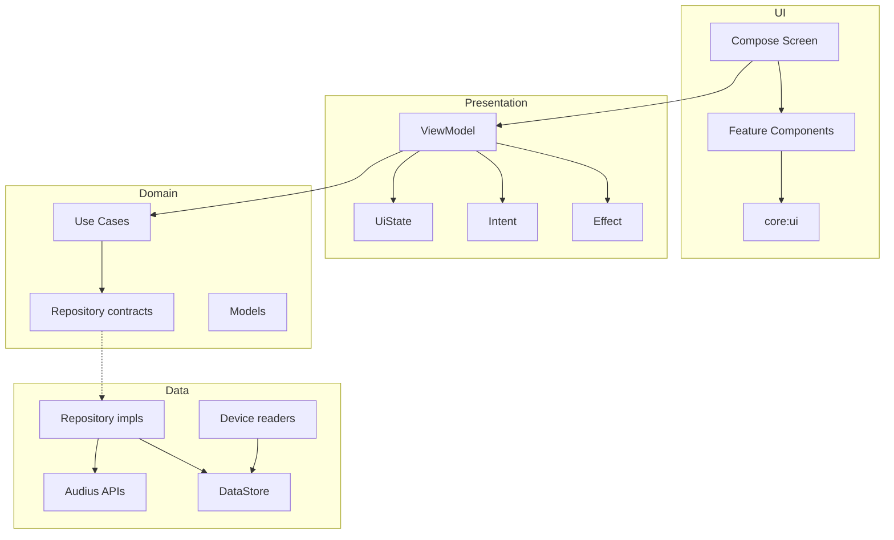
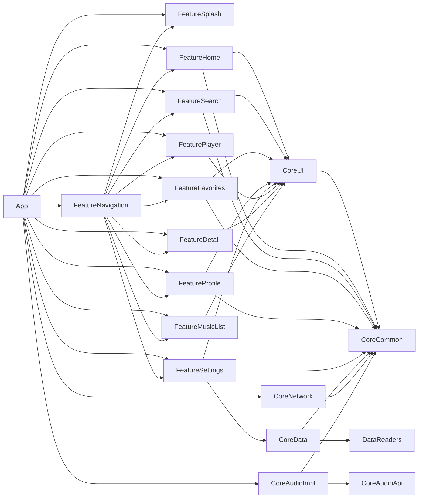
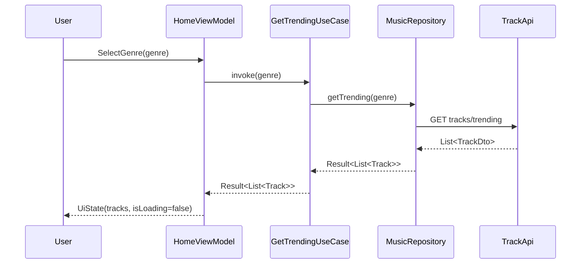
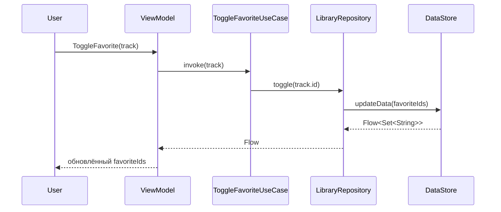
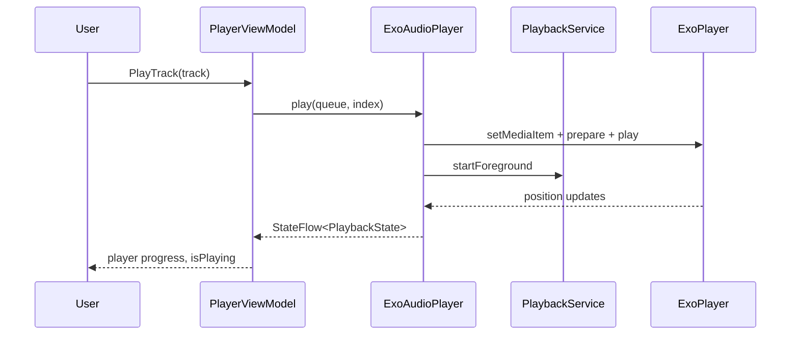
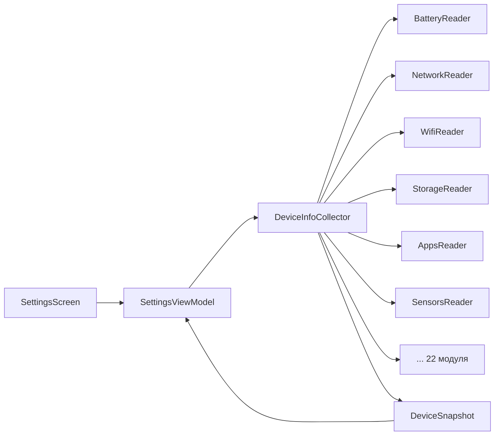

# Архитектура Sona

Документ описывает слои, зависимости модулей, DI-граф и ключевые сценарии.
Связанные документы: [экраны](SCREENS.md), [анимации](ANIMATIONS.md), [API](API.md), [модули](MODULES.md).

---

## 1. Принципы

1. **Feature-first**: каждая пользовательская фича — отдельный Gradle-модуль `api` + `impl`.
2. **Однонаправленный поток данных**: UI → Intent → ViewModel → UseCase → Repository → UI state.
3. **Контракты в `core:common`**: модели и интерфейсы не зависят от Android и сети.
4. **Зависимости внутрь**: `feature → core`, `impl → api`, `core:ui → core:common`.
5. **DI без сервис-локаторов**: всё через Dagger, конструкторный `@Inject`.
6. **Никаких `com.example.*`**: единый namespace `com.sona.*`.

---

## 2. Слои



### UI

- Только Compose, без XML-разметок (кроме темы/манифеста).
- Экраны не знают о Retrofit/DataStore.
- Локальные компоненты фичи лежат в `presentation/components`.
- Общие компоненты — `core:ui`.

### Presentation (MVI)

Каждая фича имеет:

```kotlin
data class HomeUiState(
    val isLoading: Boolean = false,
    val tracks: List<Track> = emptyList(),
    val error: String? = null,
)

sealed interface HomeIntent {
    data class SelectGenre(val genre: String?) : HomeIntent
    data class PlayTrack(val track: Track) : HomeIntent
    data object Retry : HomeIntent
}

sealed interface HomeEffect {
    data class Message(val text: String) : HomeEffect
}
```

- `StateFlow<UiState>` — единственный источник правды для UI.
- `Intent` — все действия пользователя.
- `Effect` — одноразовые события (snackbar), собираются в `LaunchedEffect`.
- ViewModel создаётся через `SonaViewModelFactory` (`core:common/presentation`).

### Domain

`core:common`:

| Пакет | Содержимое |
|---|---|
| `model` | `Track`, `Artist`, `Playlist`, `SearchResult`, `Genres`, `AudiusConfig` |
| `domain/repository` | `MusicRepository`, `LibraryRepository`, `SettingsRepository` |
| `domain/usecase` | `GetTrendingUseCase`, `SearchUseCase`, `ToggleFavoriteUseCase`, `ObserveSettingsUseCase` и др. |
| `data/repository` | реализации библиотеки и настроек поверх DataStore |
| `local` | `SonaPreferences` — ключи и DataStore |
| `coroutines` | `DispatcherProvider` (IO/Default/Main) |
| `auth` | `TokenProvider` — токен Audius для interceptor |
| `android` | проверки разрешений |
| `di` | `CoreDataModule`, qualifiers, `ViewModelKey` |

### Data

- `MusicRepositoryImpl` — в сетевом модуле, использует `TrackApi`, `PlaylistApi`, `UserApi`.
- `LibraryRepositoryImpl` — лайки и недавние треки в DataStore.
- `SettingsRepositoryImpl` — тема и токен.
- `DeviceInfoCollector` (`:core:data`) — агрегирует 28 reader-модулей.

---

## 3. Зависимости модулей



Правила:

- `api`-модули фич содержат только routes/контракты — их можно подключать без UI.
- `impl` не должен зависеть от `impl` другой фичи. Исключение — `navigation`, который собирает приложение.
- `core:ui` не знает о фичах.
- `core:common` не знает о Compose, Retrofit и Android UI.

---

## 4. DI-граф

`app/src/main/java/com/sona/music/di/AppComponent.kt`:

```kotlin
@Singleton
@Component(
    modules = [
        AppModule::class,
        NetworkModule::class,
        ApiModule::class,
        MusicModule::class,
        CoreDataModule::class,
        AudioModule::class,
        PlayerModule::class,
        ViewModelBindingModule::class,
    ],
)
interface AppComponent {
    fun inject(service: PlaybackService)
    fun viewModelFactory(): SonaViewModelFactory

    fun trackApi(): TrackApi
    fun playlistApi(): PlaylistApi
    fun userApi(): UserApi
    fun searchApi(): SearchApi
}
```

| Модуль | Что даёт |
|---|---|
| `AppModule` | `DispatcherProvider`, `@ApplicationScope CoroutineScope` |
| `NetworkModule` | `Gson`, `HttpLoggingInterceptor`, `OkHttpClient`, `Retrofit` |
| `ApiModule` | `TrackApi`, `PlaylistApi`, `UserApi`, `SearchApi` |
| `MusicModule` | `MusicRepositoryImpl` → `MusicRepository` |
| `CoreDataModule` | `LibraryRepository`, `SettingsRepository`, `TokenProvider` |
| `AudioModule` | `ExoAudioPlayer` → `AudioPlayer` |
| `PlayerModule` | `ExoPlayer` (singleton, общий для UI и сервиса) |
| `ViewModelBindingModule` | `@ViewModelKey` для всех ViewModel |

`Context` приходит в граф через `@BindsInstance @ApplicationContext` в
`AppComponent.Factory`, а не через отдельный провайд.

`SonaViewModelFactory` умеет создавать ViewModel по `@ViewModelKey`, поэтому фичи не зависят
от app-модуля напрямую.

> Полный разбор — [DI.md](DI.md): скоупы, квалификаторы, multibinding,
> инъекция в `PlaybackService`, тестирование графа и ошибки KSP.

---

## 5. Ключевые сценарии

### 5.1 Загрузка главной



- Ошибки не бросаются в UI: репозиторий возвращает `Result`.
- `DispatcherProvider.io` используется на уровне репозитория.
- Genre фильтруется на сервере, а не в памяти.

### 5.2 Поиск

`SearchViewModel` делает debounce (≈350 мс), затем параллельно дергает:

- `TrackApi.searchTracks`
- `UserApi.searchUsers`
- `PlaylistApi.searchPlaylists`

Три запроса идут в `supervisorScope`; если упали все — ошибка, если часть — показываем то, что есть.

### 5.3 Лайк



Лайки локальные: Audius-лайк отправляется только при наличии токена (задел на будущее).

### 5.4 Воспроизведение



- `PlaybackService` — foreground service с `mediaPlayback`.
- `MiniPlayer` показывается на всех экранах, кроме player/splash.
- `PlayerScreen` умеет seek, shuffle, repeat, очередь.

### 5.5 Информация об устройстве



- Каждый reader возвращает `permissionGranted=false`, если нет разрешения — без краша.
- `DeviceSnapshot` — иммутабельная сводка, читается на `LifecycleResumeEffect`.

---

## 6. Потоки и производительность

- Сетевые вызовы — `Dispatchers.IO` через `DispatcherProvider`.
- Тяжёлые чтения устройства — тоже IO.
- Compose-состояние собирается `collectAsStateWithLifecycle`.
- Изображения кэшируются Coil; кроссфейд 220 мс.
- Lazy-списки используют стабильные `key = { it.id }`.

---

## 7. Обработка ошибок

| Уровень | Стратегия |
|---|---|
| Retrofit | исключения перехватываются `runCatching` в репозитории |
| Repository | `Result<T>` |
| ViewModel | `Result` → `UiState.error` + `Effect.Message` |
| UI | `ErrorState` с retry, snackbar для одноразовых ошибок |
| Device | permission-guarded, `null`/`false` вместо исключений |

---

## 8. Тесты

- Unit-тесты: `src/test` (JUnit 4).
- Instrumented: `src/androidTest` (AndroidX Test + Espresso).
- Все модули имеют настроенный `testInstrumentationRunner`.
- Проверка сборки тестовых исходников:

```bash
./gradlew compileDebugUnitTestKotlin compileDebugAndroidTestKotlin
```
