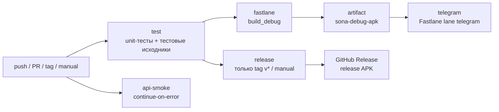

# CI/CD Sona

Sona собирается и проверяется автоматически на **GitHub Actions**.
Пайплайн прогоняет unit-тесты, собирает debug-APK через **Fastlane**,
отправляет APK в **Telegram** и — на тегах `v*` — собирает release и
прикладывает APK к GitHub Release. GitLab остаётся зеркалом репозитория.



---

## Содержание

- [Файлы](#файлы)
- [Триггеры](#триггеры)
- [Джобы](#джобы)
- [Секреты Telegram](#секреты-telegram)
- [Как получить bot token и chat id](#как-получить-bot-token-и-chat-id)
- [Fastlane](#fastlane)
- [Скрипты](#скрипты)
- [API smoke](#api-smoke)
- [Локальный прогон](#локальный-прогон)
- [Кэш и скорость](#кэш-и-скорость)
- [Troubleshooting](#troubleshooting)
- [Чек-лист первого запуска](#чек-лист-первого-запуска)

---

## Файлы

| Файл | Роль |
|---|---|
| `.github/workflows/ci.yml` | весь пайплайн: test → fastlane → release → telegram → api-smoke |
| `Gemfile` | `fastlane ~> 2.228` для `bundle install` |
| `fastlane/Appfile` | `package_name("com.sona.music")` |
| `fastlane/Fastfile` | лейны `test`, `test_sources`, `build_debug`, `build_release`, `telegram`, `ci` |
| `fastlane/README.md` | короткая шпаргалка по лейнам |
| `scripts/send-apk-telegram.sh` | `sendDocument` через `curl` (Linux/macOS/CI) |
| `scripts/send-apk-telegram.ps1` | то же для Windows PowerShell |
| `scripts/check-audius-api.sh` | live-проверка трёх эндпоинтов Audius |
| `scripts/check-audius-api.ps1` | то же для Windows |

---

## Триггеры

| Событие | Что запускается |
|---|---|
| `push` в `master` / `develop` | test, fastlane, telegram, api-smoke |
| `pull_request` в `master` / `develop` | test, fastlane, api-smoke (Telegram не шлётся) |
| тег `v*` | всё выше + release и GitHub Release |
| `workflow_dispatch` | полный пайплайн вручную, включая release |

`concurrency` отменяет предыдущий прогон той же ветки, чтобы не тратить
минуты на устаревшие коммиты.

---

## Джобы

### 1. `test` — быстрые проверки

```bash
./gradlew :core:ui:testDebugUnitTest :core:network:api:music:testDebugUnitTest
./gradlew compileDebugUnitTestKotlin compileDebugAndroidTestKotlin
```

- JDK 25 (Temurin), Android SDK, Gradle 9.5.
- Отчёты тестов (`build/reports/tests`) загружаются артефактом `test-reports`
  даже при падении (`if: always()`).
- Пока эта джоба красная, остальные не стартуют (`needs: test`).

### 2. `fastlane` — сборка debug APK

```bash
bundle exec fastlane build_debug
```

- `ruby/setup-ruby@v1` с `bundler-cache: true` — гемы ставятся из `Gemfile`
  и кэшируются.
- Fastlane вызывает `:app:assembleDebug`.
- APK уходит артефактом `sona-debug-apk`
  (`app/build/outputs/apk/debug/*.apk`).

### 3. `release` — только тег или ручной запуск

```bash
./gradlew :app:assembleRelease
```

- Собирает `app-release-unsigned.apk` (подпись настраивается отдельно,
  см. [BUILD.md](BUILD.md)).
- На теге `v*` шаг `softprops/action-gh-release@v2` прикладывает APK к
  GitHub Release и генерирует release notes.
- Артефакт `sona-release-apk` доступен и без релиза.

### 4. `telegram` — доставка APK

```bash
bundle exec fastlane telegram apk:"dist/app-debug.apk"
```

- Скачивает артефакт `sona-debug-apk` в `dist/`.
- Лейн `telegram` вызывает `scripts/send-apk-telegram.sh`.
- Если `TELEGRAM_BOT_TOKEN` или `TELEGRAM_CHAT_ID` не заданы, лейн пишет
  предупреждение и **не падает** — пайплайн остаётся зелёным.
- На `pull_request` джоба пропускается целиком.

### 5. `api-smoke` — живой Audius

```bash
bash scripts/check-audius-api.sh
```

- `continue-on-error: true`: блокировка Cloudflare не ломает сборку.
- Проверяет `tracks/trending`, `playlists/trending`, `users/search`.
- В логе видно HTTP-код и первые 200 символов ответа при ошибке.

---

## Секреты Telegram

Добавьте в GitHub: **Settings → Secrets and variables → Actions → New repository secret**.

| Секрет | Пример | Обязателен |
|---|---|---|
| `TELEGRAM_BOT_TOKEN` | `123456789:AAH...` | для доставки |
| `TELEGRAM_CHAT_ID` | `123456789` или `-1001234567890` | для доставки |

Без них сборка проходит, а шаг доставки печатает:

```text
TELEGRAM_BOT_TOKEN or TELEGRAM_CHAT_ID is missing - skipping Telegram delivery.
```

Для GitLab-зеркала те же значения добавляются в
**Settings → CI/CD → Variables** (masked, protected — по желанию).

---

## Как получить bot token и chat id

1. Откройте [@BotFather](https://t.me/BotFather) в Telegram.
2. `/newbot` → имя → username, оканчивающийся на `bot`.
3. BotFather выдаст токен вида `123456789:AAH...` — это `TELEGRAM_BOT_TOKEN`.
4. Напишите своему боту любое сообщение (иначе он не сможет писать первым).
5. Узнайте chat id:

```bash
curl "https://api.telegram.org/bot<TOKEN>/getUpdates"
```

В ответе найдите `"chat":{"id":123456789,...}` — это `TELEGRAM_CHAT_ID`.
Для группы id отрицательный (`-100...`), бота нужно добавить в группу.

6. Проверка вручную:

```bash
export TELEGRAM_BOT_TOKEN="..."
export TELEGRAM_CHAT_ID="..."
bash scripts/send-apk-telegram.sh app/build/outputs/apk/debug/app-debug.apk "Sona test"
```

> Бот не может отправить файл первым в личку, пока пользователь не начал
> диалог. Для канала бот должен быть администратором.

---

## Fastlane

| Лейн | Команда | Что делает |
|---|---|---|
| `test` | `bundle exec fastlane test` | unit-тесты |
| `test_sources` | `bundle exec fastlane test_sources` | компиляция тестовых исходников |
| `build_debug` | `bundle exec fastlane build_debug` | `assembleDebug` |
| `build_release` | `bundle exec fastlane build_release` | `assembleRelease` |
| `telegram` | `bundle exec fastlane telegram` | отправка APK |
| `ci` | `bundle exec fastlane ci` | test + test_sources + build_debug |

`Fastfile` использует `ROOT = File.expand_path("..", __dir__)`, поэтому
лейны работают из любого каталога. Путь к APK можно передать опцией:

```bash
bundle exec fastlane telegram apk:app/build/outputs/apk/release/app-release-unsigned.apk
```

---

## Скрипты

### `scripts/send-apk-telegram.sh`

```bash
TELEGRAM_BOT_TOKEN=... TELEGRAM_CHAT_ID=... \
  scripts/send-apk-telegram.sh <apk> "caption"
```

- Проверяет наличие переменных и файла.
- `curl -F document=@...` → `sendDocument`.
- Печатает размер APK и завершается с ошибкой только при реальном сбое.

### `scripts/check-audius-api.sh`

```bash
bash scripts/check-audius-api.sh
# или
AUDIUS_BASE_URL=https://api.audius.co/v1 AUDIUS_APP_NAME=Sona \
  bash scripts/check-audius-api.sh
```

Возвращает `0`, если все три эндпоинта ответили `200`, иначе `1`
(в CI это не блокирует сборку).

---

## Локальный прогон

```powershell
# 1. Тесты
.\gradlew.bat :core:ui:testDebugUnitTest :core:network:api:music:testDebugUnitTest --console=plain

# 2. Тестовые исходники
.\gradlew.bat compileDebugUnitTestKotlin compileDebugAndroidTestKotlin --console=plain

# 3. Debug APK
.\gradlew.bat :app:assembleDebug --console=plain

# 4. Проверка Audius
.\scripts\check-audius-api.ps1

# 5. Отправка APK в Telegram
$env:TELEGRAM_BOT_TOKEN = "..."
$env:TELEGRAM_CHAT_ID = "..."
.\scripts\send-apk-telegram.ps1
```

Через Fastlane:

```powershell
bundle install
bundle exec fastlane ci
```

---

## Кэш и скорость

- `gradle/actions/setup-gradle@v4` кэширует `~/.gradle` и wrapper.
- `ruby/setup-ruby` кэширует `vendor/bundle` по `Gemfile.lock`.
- `concurrency` отменяет устаревшие прогоны.
- `timeout-minutes` не даёт зависнуть на скачивании SDK.
- Первый прогон дольше: скачиваются Gradle 9.5, SDK 37, гемы.

---

## Troubleshooting

### `SDK location not found`

`android-actions/setup-android@v3` создаёт `ANDROID_HOME`. Если платформа
не установилась, добавьте шаг:

```yaml
- run: sdkmanager "platforms;android-37"
```

### `Failed to install the following Android SDK packages`

Примите лицензии:

```bash
yes | sdkmanager --licenses
```

### Telegram: `chat not found`

- Пользователь не начал диалог с ботом.
- Для группы бот не добавлен в участники.
- `TELEGRAM_CHAT_ID` — не id бота, а id получателя.

### Telegram: `Request Entity Too Large`

У Bot API лимит 50 МБ на `sendDocument`. Debug APK Sona ~29 МБ, release ~19 МБ —
запаса хватает. Если APK вырос, используйте `sendDocument` с ссылкой на
артефакт или сожмите ресурсы.

### `403` от `api.audius.co`

Cloudflare блокирует датацентровые IP. Это ожидаемо для GitHub Actions;
джоба `api-smoke` помечена `continue-on-error`. На реальном устройстве
запросы проходят.

### `DaggerAppComponent` не найден

KSP-шаг не отработал. Смотрите [DI.md](DI.md#ошибки-ksp-и-что-они-значат).

### Fastlane: `Could not find gem 'fastlane'`

```bash
bundle install
```

или проверьте, что `Gemfile.lock` закоммичен.

---

## Чек-лист первого запуска

1. Ветка `develop` (или `master`) запушена на GitHub.
2. В **Actions** появился workflow **CI/CD**.
3. `test` и `fastlane` зелёные.
4. Добавлены `TELEGRAM_BOT_TOKEN` и `TELEGRAM_CHAT_ID`.
5. Повторный запуск (или push) → в Telegram пришёл APK.
6. Тег `v1.1.0` → в GitHub Releases лежит `app-release-unsigned.apk`.
7. `api-smoke` может быть жёлтым — это не блокер.

---

Дальше: [сборка](BUILD.md) · [DI](DI.md) · [архитектура](ARCHITECTURE.md).
