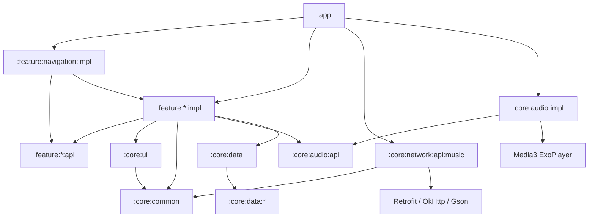

# Модули Sona

Проект — многомодульный Gradle-проект: **73+ модулей**, сгруппированных в
`core`, `feature` и `app`. Такой разрез позволяет:

- держать UI фичи изолированным от сети и DataStore;
- переиспользовать общие Compose-компоненты;
- подключать только нужные API;
- собирать и тестировать модули параллельно.

---

## Содержание

- [Дерево модулей](#дерево-модулей)
- [app](#app)
- [core:common](#corecommon)
- [core:ui](#coreui)
- [core:network](#corenetwork)
- [core:audio](#coreaudio)
- [core:data](#coredata)
- [28 device-модулей](#28-device-модулей)
- [core:cache, core:camera, core:worker](#corecache-corecamera-coreworker)
- [feature-модули](#feature-модули)
- [Правила зависимостей](#правила-зависимостей)
- [Как добавить фичу](#как-добавить-фичу)
- [Как добавить эндпоинт](#как-добавить-эндпоинт)
- [Заготовки](#заготовки)

---

## Дерево модулей

```text
Sona/
├── app/                              :app
├── core/
│   ├── common/                       :core:common
│   ├── ui/                           :core:ui
│   ├── data/                         :core:data
│   │   ├── alarms/                   :core:data:alarms
│   │   ├── apps/                     :core:data:apps
│   │   ├── battery/                  :core:data:battery
│   │   ├── bluetooth/                :core:data:bluetooth
│   │   ├── browser/                  :core:data:browser
│   │   ├── clipboard/                :core:data:clipboard
│   │   ├── contacts/                 :core:data:contacts
│   │   ├── device/                   :core:data:device
│   │   ├── display/                  :core:data:display
│   │   ├── documents/                :core:data:documents
│   │   ├── downloads/                :core:data:downloads
│   │   ├── gallery/                  :core:data:gallery
│   │   ├── hardware/                 :core:data:hardware
│   │   ├── location/                 :core:data:location
│   │   ├── media/                    :core:data:media
│   │   ├── network/                  :core:data:network
│   │   ├── nfc/                      :core:data:nfc
│   │   ├── notifications/            :core:data:notifications
│   │   ├── performance/              :core:data:performance
│   │   ├── permissions/              :core:data:permissions
│   │   ├── sensors/                  :core:data:sensors
│   │   ├── sms/                      :core:data:sms
│   │   ├── sound/                    :core:data:sound
│   │   ├── storage/                  :core:data:storage
│   │   ├── usage/                    :core:data:usage
│   │   ├── usb/                      :core:data:usb
│   │   ├── vpn/                      :core:data:vpn
│   │   └── wifi/                     :core:data:wifi
│   ├── network/
│   │   ├── api/music/                :core:network:api:music
│   │   ├── firebase/auth/            :core:network:firebase:auth
│   │   └── supabase/auth/            :core:network:supabase:auth
│   ├── audio/
│   │   ├── api/                      :core:audio:api
│   │   └── impl/                     :core:audio:impl
│   ├── cache/
│   │   ├── api/                      :core:cache:api
│   │   └── impl/                     :core:cache:impl
│   ├── camera/
│   │   ├── api/                      :core:camera:api
│   │   └── impl/                     :core:camera:impl
│   └── worker/sync/                  :core:worker:sync
└── feature/
    ├── navigation/{api,impl}/        :feature:navigation:api / :impl
    ├── splashscreen/{api,impl}/      :feature:splashscreen:api / :impl
    ├── home/{api,impl}/              :feature:home:api / :impl
    ├── searchmusic/{api,impl}/       :feature:searchmusic:api / :impl
    ├── favorites/{api,impl}/         :feature:favorites:api / :impl
    ├── profile/{api,impl}/           :feature:profile:api / :impl
    ├── detailmusic/{api,impl}/       :feature:detailmusic:api / :impl
    ├── musiclist/{api,impl}/         :feature:musiclist:api / :impl
    ├── player/{api,impl}/            :feature:player:api / :impl
    ├── settings/{api,impl}/          :feature:settings:api / :impl
    └── comments/{api,impl}/          :feature:comments:api / :impl
```

---

## app

**`:app`** — Android application.

| Компонент | Ответственность |
|---|---|
| `SonaApplication` | создаёт `DaggerAppComponent`, реализует `PlaybackServiceInjector` |
| `MainActivity` | edge-to-edge, запрос `POST_NOTIFICATIONS`, запуск `PlaybackService`, `setContent { SonaApp(...) }` |
| `AppComponent` | единый Dagger-граф |
| `AppModule` | `DispatcherProvider`, application `CoroutineScope` |
| `ViewModelBindingModule` | `@ViewModelKey` для всех ViewModel |
| `AndroidManifest.xml` | permissions, `MainActivity`, `PlaybackService` |

`applicationId` = `com.sona.music`, `versionCode` = 1, `versionName` = `1.0`.

---

## core:common

**`:core:common`** — доменное ядро и общие данные. Android-библиотека, но без
Compose-экранов.

| Пакет | Содержимое |
|---|---|
| `model` | `Track`, `Artist`, `Playlist`, `SearchResult`, `Genres`, `AudiusConfig`, `ThemeMode`, `RepeatMode` |
| `domain/repository` | `MusicRepository`, `LibraryRepository`, `SettingsRepository` |
| `domain/usecase` | `GetTrendingTracks`, `SearchCatalog`, `GetTrack`, `GetArtist`, `GetArtistTracks`, `GetPlaylist`, `GetPlaylistTracks`, `GetCurrentUser`, `ToggleFavorite`, `ObserveFavorites`, `ObserveFavoriteIds`, `ObserveRecentlyPlayed`, `AddRecentlyPlayed`, `ObserveSettings`, `SetThemeMode`, `SetApiToken`, `ClearLibrary` |
| `data/repository` | `LibraryRepositoryImpl`, `SettingsRepositoryImpl` |
| `local` | `SonaPreferences` — DataStore `sona_prefs` |
| `auth` | `TokenProvider` |
| `coroutines` | `DispatcherProvider`, `DefaultDispatcherProvider` |
| `android` | проверки runtime-разрешений |
| `di` | `CoreDataModule`, `@ApplicationContext`, `@ApplicationScope`, `@IoDispatcher`, `ViewModelKey` |
| `presentation` | `SonaViewModelFactory` |

DataStore-ключи:

| Ключ | Тип | Что хранит |
|---|---|---|
| `theme_mode` | String | `SYSTEM` / `LIGHT` / `DARK` |
| `api_token` | String | Audius bearer token |
| `favorites_json` | String | список лайкнутых треков (JSON) |
| `recently_played_json` | String | история (JSON, ограничена) |

---

## core:ui

**`:core:ui`** — общие Compose-компоненты, тема и форматтеры. Не знает о фичах.

| Пакет | Содержимое |
|---|---|
| `component` | `Artwork`, `TrackRow`, `TrackTile`, `ArtistRow`, `ArtistTile`, `PlaylistRow`, `PlayingIndicator`, `MiniPlayer`, `SonaBackground`, `SonaLogo`, `SonaChip`, `SectionHeader`, `EmptyState`, `ErrorState`, `LoadingState`, `GradientCircleButton`, `CircleIconButton`, `OutlinePill`, `StatPill` |
| `theme` | `Color.kt`, `Type.kt`, `Shape.kt`, `Theme.kt` (`SonaTheme`) |
| `format` | `formatDuration`, `formatCount`, `greetingForNow` |
| `util` | `IntentExt`: `shareText`, `openUrl`, `shareTrack` |
| `res/drawable` | `ic_sona_mark` — аватар приложения (splash, Home, launcher icon) |

Правило: если компонент нужен **двум и более** фичам — он живёт здесь.
Если одному — в `feature/*/impl/presentation/components`.

---

## core:network

### :core:network:api:music

Android-библиотека `com.sona.core.network.audius`.

```text
api/          TrackApi, PlaylistApi, UserApi, SearchApi
di/           NetworkModule, ApiModule, MusicModule
dto/          TrackDto, UserDto, PlaylistDto, CommentDto, envelope
mapper/       toDomain / toDomainOrNull
interceptor/  AuthInterceptor
model/        SortMethod, SortDirection, FilterTracks, SortAi
repository/   MusicRepositoryImpl
```

`NetworkModule` даёт `Gson`, `OkHttpClient`, `Retrofit`; `ApiModule` — четыре API;
`MusicModule` биндит `MusicRepositoryImpl` на `MusicRepository`.

### :core:network:firebase:auth, :core:network:supabase:auth

Заготовки под альтернативную авторизацию. В текущем релизе не используются.

---

## core:audio

### :core:audio:api

Контракт плеера, не зависящий от Media3:

```kotlin
interface AudioPlayer {
    val state: StateFlow<PlayerState>
    fun playQueue(tracks: List<Track>, startIndex: Int = 0)
    fun togglePlayPause()
    fun play()
    fun pause()
    fun next()
    fun previous()
    fun seekTo(positionMs: Long)
    fun selectQueueItem(index: Int)
    fun addToQueue(track: Track)
    fun setShuffle(enabled: Boolean)
    fun cycleRepeatMode()
}
```

`PlayerState` содержит очередь, индекс, playing/buffering, позицию, длительность,
shuffle, repeat, error и вычисляемые `currentTrack`, `hasNext`, `hasPrevious`, `progress`.

### :core:audio:impl

| Файл | Ответственность |
|---|---|
| `player/ExoAudioPlayer` | Media3 ExoPlayer, очередь, shuffle, repeat, seek, state |
| `service/PlaybackService` | foreground-service `mediaPlayback` |
| `service/PlaybackServiceInjector` | интерфейс внедрения Dagger в сервис |
| `di/AudioModule` | `ExoPlayer`, `AudioPlayer`, MediaSession |
| `di/PlayerModule` | зависимости `PlayerViewModel` |

`PlaybackService` объявлен в `core/audio/impl/src/main/AndroidManifest.xml`
(`exported=false`, `foregroundServiceType=mediaPlayback`).

---

## core:data

**`:core:data`** — агрегатор информации об устройстве.

`DeviceInfoCollector` создаёт 28 reader'ов и умеет:

- вызывать каждый источник отдельно (`battery()`, `wifi()`, …);
- собирать всё параллельно через `coroutineScope { async { ... } }`;
- возвращать иммутабельный `DeviceSnapshot`.

Каждый reader:

1. проверяет runtime-разрешение;
2. при отсутствии доступа возвращает пустые данные / `permissionGranted=false`;
3. никогда не бросает исключение в UI.

`SettingsViewModel` вызывает `snapshot()` и превращает его в `DeviceSummary`
(модель, Android, батарея, сеть, память, приложения, датчики, разрешения).

---

## 28 device-модулей

| Модуль | Что читает | Разрешение |
|---|---|---|
| `alarms` | будильники | `SET_ALARM` / чтение |
| `apps` | установленные приложения | `QUERY_ALL_PACKAGES` |
| `battery` | уровень, статус, температура | — |
| `bluetooth` | адаптер, подключённые устройства | `BLUETOOTH_CONNECT` |
| `browser` | история браузера | нет (ограничено) |
| `clipboard` | последний клип | foreground / ограничение ОС |
| `contacts` | контакты | `READ_CONTACTS` |
| `device` | производитель, модель, SDK | — |
| `display` | разрешение, плотность, refresh rate | — |
| `documents` | документы | `READ_EXTERNAL_STORAGE` / SAF |
| `downloads` | загрузки | `READ_MEDIA_*` / storage |
| `gallery` | изображения | `READ_MEDIA_IMAGES` |
| `hardware` | CPU, RAM, ядра | — |
| `location` | последняя локация | `ACCESS_FINE_LOCATION` |
| `media` | аудио/видео | `READ_MEDIA_AUDIO` / `VIDEO` |
| `network` | транспорт, скорость | `ACCESS_NETWORK_STATE` |
| `nfc` | адаптер NFC | `NFC` |
| `notifications` | активные уведомления | `NotificationListenerService` |
| `performance` | память процесса, потоки | — |
| `permissions` | выданные разрешения | — |
| `sensors` | список датчиков | — |
| `sms` | SMS | `READ_SMS` |
| `sound` | режимы звука, громкость | — |
| `storage` | внутренняя/внешняя память | — |
| `usage` | статистика использования | `PACKAGE_USAGE_STATS` |
| `usb` | подключённые USB-устройства | — |
| `vpn` | активный VPN | — |
| `wifi` | SSID, сигнал, скорость | `ACCESS_FINE_LOCATION` (для SSID) |

Разрешения объявлены в манифесте, но **не запрашиваются автоматически**.
В Settings есть кнопка «Manage permissions», открывающая системный экран
приложения. Это сделано осознанно: приложение не должно просить 20 разрешений
при старте.

---

## core:cache, core:camera, core:worker

| Модуль | Статус | Назначение |
|---|---|---|
| `:core:cache:api` / `:core:cache:impl` | заготовка | будущий кэш ответов/аудио |
| `:core:camera:api` / `:core:camera:impl` | заготовка | будущая камера |
| `:core:worker:sync` | заготовка | будущая фоновая синхронизация |

Эти модули подключены в `settings.gradle.kts`, но не входят в runtime-граф
основного приложения.

---

## feature-модули

Каждая фича = `api` + `impl`.

| Фича | `api` | `impl` |
|---|---|---|
| `navigation` | пусто | `SonaApp`, `AppViewModel`, `SonaBottomBar` |
| `splashscreen` | `SplashDestination` | `SplashScreen`, `SplashBrand` |
| `home` | `HomeDestination` | `HomeScreen`, `HomeViewModel`, `HomeComponents` |
| `searchmusic` | `SearchDestination` | `SearchScreen`, `SearchViewModel`, `SearchComponents` |
| `favorites` | `FavoritesDestination` | `FavoritesScreen`, `FavoritesViewModel`, `FavoritesHero` |
| `profile` | `ProfileDestination` | `ProfileScreen`, `ProfileViewModel`, `ProfileComponents` |
| `detailmusic` | `DetailMusicDestination` | `DetailMusicScreen`, `DetailMusicViewModel`, `TrackDetailHero` |
| `musiclist` | `MusicListDestination` | `MusicListScreen`, `MusicListViewModel`, `CollectionHero` |
| `player` | `PlayerDestination` | `PlayerScreen`, `PlayerViewModel`, `PlayerComponents` |
| `settings` | `SettingsDestination` | `SettingsScreen`, `SettingsViewModel`, `SettingsComponents` |
| `comments` | `CommentData` | заготовка |

### Почему `api` — JVM-модуль

`feature/*/api` содержит только `object *Destination` с route и `createRoute`.
Это чистый Kotlin/JVM (`java-library` + `kotlin-jvm`), без Android и Compose.
Благодаря этому:

- `navigation` может зависеть от route любой фичи, не тянув её UI;
- route можно тестировать обычным JUnit;
- время компиляции меньше.

### Почему `impl` — Android-модуль

`impl` содержит Compose, ViewModel, Hilt/Dagger-аннотации, ресурсы. Он зависит
от `:core:ui`, `:core:common`, `:core:audio:api` и своего `api`.

---

## Правила зависимостей



Запрещено:

- `feature:A:impl` → `feature:B:impl` (кроме `navigation`);
- `core:ui` → любая `feature`;
- `core:common` → Compose / Retrofit / Android UI;
- `core:audio:api` → Media3 (Media3 только в `impl`);
- `com.example.*` — только `com.sona.*`.

Разрешено:

- `navigation:impl` → `feature:*:impl` (сборка приложения);
- `feature:*:impl` → `feature:*:api`;
- `core:data` → `core:data:*`;
- `app` → всё.

---

## Как добавить фичу

1. Создать модули:

```text
feature/example/api/build.gradle.kts    (java-library + kotlin-jvm)
feature/example/impl/build.gradle.kts   (android.library + compose + ksp)
```

2. В `settings.gradle.kts`:

```kotlin
include(":feature:example:api")
include(":feature:example:impl")
```

3. В `api` — route:

```kotlin
object ExampleDestination {
    const val ROUTE: String = "example"
}
```

4. В `impl` — `ExampleUiState.kt`, `ExampleViewModel.kt`, `ExampleScreen.kt`,
   `presentation/components/`.

5. Забиндить ViewModel в `ViewModelBindingModule`:

```kotlin
@Binds @IntoMap @ViewModelKey(ExampleViewModel::class)
abstract fun bindExampleViewModel(vm: ExampleViewModel): ViewModel
```

6. Добавить `composable(ExampleDestination.ROUTE)` в `SonaApp.kt`.

7. Добавить `implementation(project(":feature:example:impl"))` в `:app`.

8. Обновить `docs/SCREENS.md`, `docs/MODULES.md`, `README.md`.

---

## Как добавить эндпоинт

1. Выбрать доменный интерфейс: `TrackApi`, `PlaylistApi`, `UserApi`, `SearchApi`.
2. Добавить метод с `@GET` / `@POST` / `@DELETE` / `@PUT` и `@Query`.
3. Если ответ сложный — добавить DTO в `dto/AudiusDtos.kt`.
4. Если нужен доменный объект — добавить маппер в `mapper/AudiusMappers.kt`.
5. Добавить метод в `MusicRepository` и `MusicRepositoryImpl`.
6. Написать use case в `core/common/domain/usecase`.
7. Использовать в ViewModel.
8. Обновить `docs/API.md` и `core/network/api/music/README.md`.

---

## Заготовки

| Модуль | Что уже есть | Чего нет |
|---|---|---|
| `comments` | `CommentData` | UI, ViewModel, API-интеграция |
| `cache` | пустые `api` / `impl` | реализация |
| `camera` | пустые `api` / `impl` | реализация |
| `worker:sync` | модуль | Worker, планировщик |
| `firebase:auth` | модуль | провайдер |
| `supabase:auth` | модуль | провайдер |

Заготовки не ломают сборку: они либо пустые, либо содержат только контракт.

---

Дальше: [архитектура](ARCHITECTURE.md) · [DI](DI.md) · [экраны](SCREENS.md) · [анимации](ANIMATIONS.md) · [API](API.md) · [сборка](BUILD.md).
