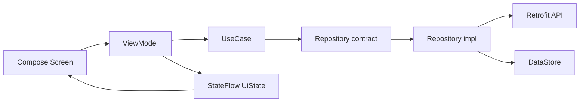

# Документация Sona

Sona — Android-плеер и стриминговый клиент открытой музыкальной сети
[Audius](https://audius.co). Приложение полностью написано на Kotlin + Jetpack
Compose и собрано из 74 Gradle-модулей.

Этот файл — точка входа в документацию. В корне репозитория намеренно лежит
только один Markdown-файл — [`../README.md`](../README.md); все остальные
документы находятся в `docs/`.

---

## Содержание

- [Быстрый старт](#быстрый-старт)
- [Карта документации](#карта-документации)
- [Архитектура в одном экране](#архитектура-в-одном-экране)
- [Как читать документацию](#как-читать-документацию)
- [Правила репозитория](#правила-репозитория)
- [Качество и проверки](#качество-и-проверки)

---

## Быстрый старт

```bash
# debug-сборка
./gradlew :app:assembleDebug

# все unit-тесты
./gradlew testDebugUnitTest

# release-сборка (unsigned)
./gradlew :app:assembleRelease

# компиляция unit- и instrumentation-тестов без запуска
./gradlew compileDebugUnitTestKotlin compileDebugAndroidTestKotlin
```

На Windows используйте `gradlew.bat`. APK появится в
`app/build/outputs/apk/debug/app-debug.apk` и
`app/build/outputs/apk/release/app-release-unsigned.apk`.

Требования, JDK/SDK, подпись и troubleshooting — в [BUILD.md](BUILD.md).

---

## Карта документации

| Документ | О чём | Кому |
|---|---|---|
| [ARCHITECTURE.md](ARCHITECTURE.md) | слои, MVI-поток, модульный граф, DI, threading, обработка ошибок, тестовые швы | всем разработчикам |
| [MODULES.md](MODULES.md) | дерево 74 модулей, правила зависимостей, рецепт новой фичи | архитекторам, новичкам |
| [DI.md](DI.md) | Dagger 2: `AppComponent`, модули, скоупы, ViewModel, KSP-ошибки | разработчикам фич |
| [SCREENS.md](SCREENS.md) | 9 экранов: состояния, интенты, эффекты, компоненты, навигация | UI-разработчикам |
| [ANIMATIONS.md](ANIMATIONS.md) | переходы, splash, эквалайзер, тайминги, как менять анимации | UI-разработчикам, дизайнерам |
| [API.md](API.md) | Audius API по доменам, DTO, маппинг, стриминг, ошибки | сетевым разработчикам |
| [TESTING.md](TESTING.md) | матрица 142 тестов, фейки, `MainDispatcherRule`, правила и CI | всем разработчикам |
| [CI_CD.md](CI_CD.md) | GitHub Actions, Fastlane, Telegram-бот, API smoke, секреты | мейнтейнерам |
| [FASTLANE.md](FASTLANE.md) | шпаргалка по лейнам Fastlane | мейнтейнерам, релиз-инженерам |
| [BUILD.md](BUILD.md) | требования, команды, APK, подпись, troubleshooting | всем разработчикам |
| [CHANGELOG.md](CHANGELOG.md) | история версий, тестов и проверок | всем |

Дополнительно: [корневой README](../README.md) — возможности, экраны, бренд,
навигация и краткая архитектура. Внутри сетевого модуля есть
[`core/network/api/music/README.md`](../core/network/api/music/README.md) —
локальная памятка по Audius API.

---

## Архитектура в одном экране



1. **UI** — Compose-экран собирает состояние и отправляет интенты.
2. **Presentation** — `ViewModel` обрабатывает интенты, вызывает use case,
   обновляет `StateFlow<UiState>` и отправляет одноразовые `Effect`.
3. **Domain** — чистые модели и контракты в `core:common`, use cases без
   Android-зависимостей.
4. **Data** — реализация репозиториев, Audius API, DataStore, device-info
   readers.
5. **DI** — Dagger 2, конструкторный `@Inject`, без сервис-локаторов.

Подробный разбор, включая `DeviceSnapshotProvider` и тестовые швы, —
в [ARCHITECTURE.md](ARCHITECTURE.md#9-тестируемость-и-швы).

---

## Как читать документацию

| Ваша задача | Порядок чтения |
|---|---|
| Впервые открыли проект | [README](../README.md) → [ARCHITECTURE](ARCHITECTURE.md) → [MODULES](MODULES.md) → [BUILD](BUILD.md) |
| Добавляете экран или фичу | [MODULES](MODULES.md) → [DI](DI.md) → [SCREENS](SCREENS.md) → [TESTING](TESTING.md) |
| Работаете с Audius API | [API](API.md) → [ARCHITECTURE](ARCHITECTURE.md#7-обработка-ошибок) → [TESTING](TESTING.md) |
| Меняете анимации | [ANIMATIONS](ANIMATIONS.md) → [SCREENS](SCREENS.md) |
| Настраиваете доставку APK | [CI_CD](CI_CD.md) → [FASTLANE](FASTLANE.md) |
| Ищете, что изменилось | [CHANGELOG](CHANGELOG.md) |

---

## Правила репозитория

- В корне — только `README.md` из Markdown-файлов и файлы сборки
  (`build.gradle.kts`, `settings.gradle.kts`, `gradle.properties`, `gradlew*`,
  `Gemfile*`, `.gitignore`, `local.properties`).
- Вся документация — в `docs/`. Новый документ добавляется в карту выше и в
  раздел «Документация» корневого README.
- Язык документации — русский; код, идентификаторы и команды — английский.
- Namespace только `com.sona.*`, никаких `com.example.*`.
- Каждая фича — отдельный Gradle-модуль `api` + `impl`.
- Изменение поведения сопровождается тестом; изменение контракта — правкой
  документации.

---

## Качество и проверки

| Проверка | Команда | Где описано |
|---|---|---|
| Unit-тесты | `./gradlew testDebugUnitTest` | [TESTING.md](TESTING.md) |
| Компиляция тестов | `./gradlew compileDebugUnitTestKotlin compileDebugAndroidTestKotlin` | [TESTING.md](TESTING.md) |
| Debug APK | `./gradlew :app:assembleDebug` | [BUILD.md](BUILD.md) |
| Release APK | `./gradlew :app:assembleRelease` | [BUILD.md](BUILD.md) |
| Полный CI-прогон | `bundle exec fastlane ci` | [FASTLANE.md](FASTLANE.md), [CI_CD.md](CI_CD.md) |
| Live Audius | `scripts/check-audius-api.ps1` / `.sh` | [CI_CD.md](CI_CD.md#api-smoke) |

Текущее состояние: **142 unit-теста** в 12 модулях (132 содержательных и 10
шаблонных `ExampleUnitTest`), 0 падений; debug и release собираются без
устройства.

---

## Связанные ссылки

- Исходный код: [github.com/JamikKhidirov/Sona](https://github.com/JamikKhidirov/Sona)
- Зеркало: [gitlab.com/dzamikhidirov8/Sona](https://gitlab.com/dzamikhidirov8/Sona)
- Audius: [audius.co](https://audius.co) · [API docs](https://docs.audius.org)
