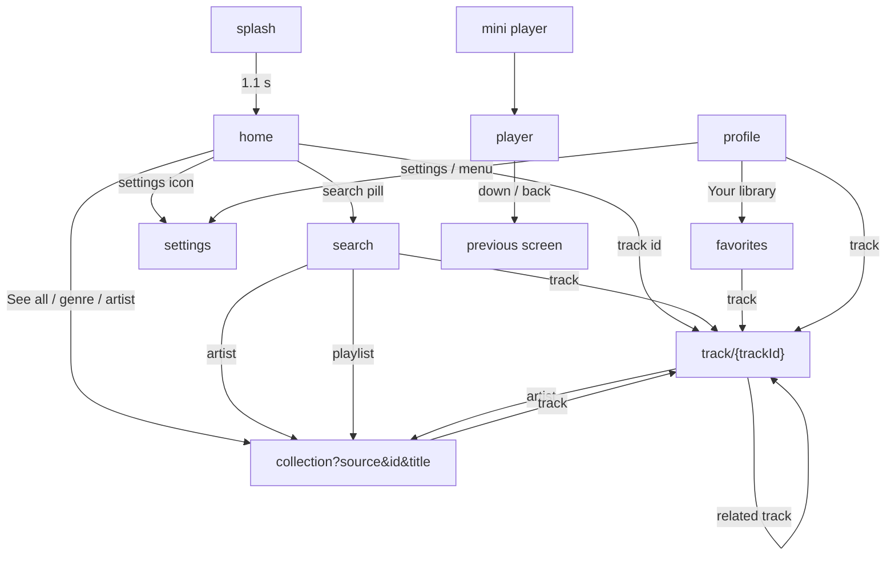
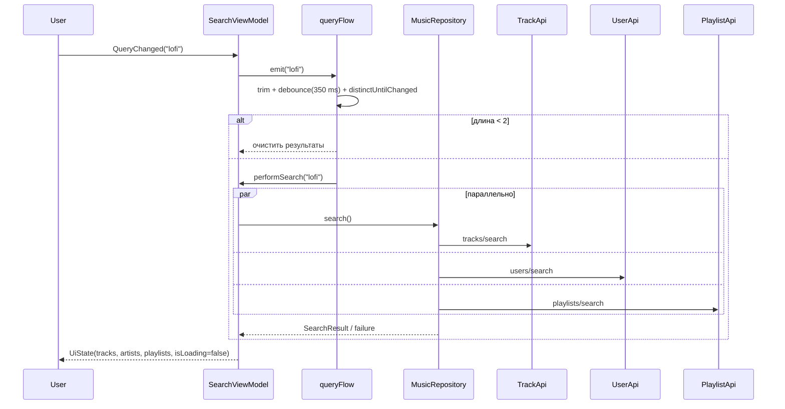

# Экраны Sona

Подробный разбор каждого экрана: маршрут, состояние, интенты, эффекты, структура UI,
компоненты и переходы. Общая архитектура — в [ARCHITECTURE.md](ARCHITECTURE.md),
анимации — в [ANIMATIONS.md](ANIMATIONS.md), API — в [API.md](API.md).


---

## Содержание

- [Общие правила](#общие-правила)
- [Карта экранов](#карта-экранов)
- [Splash](#splash)
- [Home](#home)
- [Search](#search)
- [Favorites](#favorites)
- [Profile](#profile)
- [Track details](#track-details)
- [Collection](#collection)
- [Player](#player)
- [Settings](#settings)
- [Навигационная оболочка](#навигационная-оболочка)
- [Сводная таблица состояний](#сводная-таблица-состояний)

---

## Общие правила

Каждая фича построена по одной схеме:

```text
Route (Compose)  →  ViewModel.onIntent(Intent)  →  UseCase  →  Repository
       ↑                                                        │
       └──────────── StateFlow<UiState>  ←  MutableStateFlow ←───┘
       └──────────── SharedFlow<Effect>  →  snackbar / one-shot
```

| Элемент | Правило |
|---|---|
| `*Route` | Точка входа из `NavHost`. Создаёт ViewModel, собирает state, слушает effects |
| `*Screen` | Приватная чистая Compose-функция: только `state` + колбэки, без ViewModel |
| `*UiState` | `data class` с вычисляемыми свойствами (`featured`, `totalDurationSeconds`, …) |
| `*Intent` | `sealed interface`, все действия пользователя |
| `*Effect` | `sealed interface`, одноразовые сообщения (`Message(text)`) |
| `presentation/components/` | Локальные UI-компоненты фичи |
| `:core:ui` | Общие компоненты: `TrackRow`, `Artwork`, `EmptyState`, `ErrorState`, … |

Навигационные колбэки (`onOpenTrack`, `onOpenList`, `onBack`, …) передаются сверху —
экраны ничего не знают о `NavController`.

---

## Карта экранов



| # | Экран | Route | Файлы |
|---|---|---|---|
| 1 | Splash | `splash` | `feature/splashscreen/**` |
| 2 | Home | `home` | `feature/home/**` |
| 3 | Search | `search` | `feature/searchmusic/**` |
| 4 | Favorites | `favorites` | `feature/favorites/**` |
| 5 | Profile | `profile` | `feature/profile/**` |
| 6 | Track details | `track/{trackId}` | `feature/detailmusic/**` |
| 7 | Collection | `collection?source={source}&id={id}&title={title}` | `feature/musiclist/**` |
| 8 | Player | `player` | `feature/player/**` |
| 9 | Settings | `settings` | `feature/settings/**` |

---

## Splash

**Файл:** `feature/splashscreen/impl/src/main/java/com/sona/feature/splashscreen/impl/presentation/SplashScreen.kt`

| Параметр | Значение |
|---|---|
| Route | `splash` |
| Аргументы | нет |
| Состояние | нет |
| Интенты | нет |
| Эффекты | нет |
| Длительность | `delay(1_100L)` |

Что происходит:

1. `SonaBackground` рисует фирменный градиент.
2. `SplashBrand` показывает **аватар приложения** — тот же `ic_sona_mark`, что и
   в launcher-иконке. Аватар входит пружиной (0.82 → 1.0, ~600 ms), затем
   «дышит» 1 → 1.045 → 1 с периодом 1.6 s; позади пульсирует радиальное
   свечение.
3. Через 250 ms проявляется `SONA`, ниже — слоган и `CircularProgressIndicator`.
4. Через 1.1 секунды вызывается `onFinished`.
5. `NavHost` уводит на `home` с `popUpTo(splash) { inclusive = true }` — назад на splash вернуться нельзя.

Компоненты: `SonaBackground`, `SplashBrand`, `SonaLogo`.

Анимации splash подробно разобраны в
[docs/ANIMATIONS.md](ANIMATIONS.md#splash-и-аватар-приложения).

---

## Home

**Файлы:**

- `HomeRoute` / `HomeScreen` — `.../home/impl/presentation/HomeScreen.kt`
- `HomeUiState`, `HomeIntent`, `HomeEffect` — `.../HomeUiState.kt`
- `HomeViewModel` — `.../HomeViewModel.kt`
- `HomeHeader`, `HomeSearchPill`, `FeaturedTrackCard` — `.../presentation/components/HomeComponents.kt`

### Состояние

```kotlin
data class HomeUiState(
    val isLoading: Boolean = true,
    val tracks: List<Track> = emptyList(),
    val favoriteIds: Set<String> = emptySet(),
    val selectedGenre: String? = null,
    val currentTrackId: String? = null,
    val isPlaying: Boolean = false,
    val error: String? = null,
) {
    val featured: Track? get() = tracks.firstOrNull()
    val trending: List<Track> get() = tracks.drop(1)
    val freshDrops: List<Track> get() = tracks.drop(1).take(10)
    val artists get() = tracks.map { it.artist }.distinctBy { it.id }.take(14)
}
```

Один сетевой ответ `tracks/trending?limit=50` раскладывается на четыре блока:
featured (первый трек), trending, fresh drops и артисты.

### Интенты

| Intent | Действие |
|---|---|
| `SelectGenre(genre)` | Повторный клик по выбранному жанру сбрасывает фильтр; иначе грузит `trending?genre=` |
| `PlayTrack(track)` | Если трек уже играет — play/pause, иначе `playQueue(tracks, index)` |
| `ToggleFavorite(track)` | Локальный лайк + snackbar «Saved/Removed» |
| `PlayFeatured` | Играет первый трек подборки |
| `Retry` | Повторная загрузка с текущим жанром |

### Эффекты

`HomeEffect.Message(text)` → `SnackbarHost` внизу экрана.

### Структура UI

| Блок | Содержимое |
|---|---|
| Header | приветствие по времени суток, аватар-заглушка, кнопка настроек |
| Hero-текст | «Find your next obsession» |
| Поиск | `HomeSearchPill` → экран `search` |
| Жанры | `LazyRow`: `All` + 12 жанров из `Genres.all` |
| Featured | крупная карточка с обложкой, play и переходом на трек |
| Trending now | заголовок + «See all» + до 8 `TrackRow` |
| Fresh drops | горизонтальный `LazyRow` из `TrackTile` |
| Artists to watch | горизонтальный `LazyRow` из `ArtistTile` |
| Footer | «Powered by the Audius open network» |

### Переходы

| Действие | Куда |
|---|---|
| Карточка/строка трека | `track/{trackId}` |
| See all (без жанра) | `collection?source=trending&id=all&title=Trending now` |
| See all (жанр) | `collection?source=genre&id={genre}&title={genre}` |
| Fresh drops → Explore | `collection?source=trending&id=all&title=Fresh drops` |
| Артист | `collection?source=artist&id={artistId}&title={name}` |
| Поиск | `search` (top-level) |
| Настройки | `settings` |

### Состояния

| Условие | UI |
|---|---|
| `isLoading && tracks.isEmpty()` | `LoadingState` |
| `error != null && tracks.isEmpty()` | `ErrorState` + Retry |
| `tracks.isEmpty()` | `EmptyState` «Nothing on the dial» + Refresh |
| есть данные | Полный feed |

---

## Search

**Файлы:**

- `SearchRoute` / `SearchScreen` — `.../searchmusic/impl/presentation/SearchScreen.kt`
- `SearchUiState`, `SearchIntent`, `SearchEffect`, `SearchTab` — `.../SearchUiState.kt`
- `SearchViewModel` — `.../SearchViewModel.kt`
- `SearchField`, `BrowseGenres`, `GenreCard` — `.../presentation/components/SearchComponents.kt`

### Состояние

```kotlin
enum class SearchTab(val label: String) { TRACKS, ARTISTS, PLAYLISTS }

data class SearchUiState(
    val query: String = "",
    val selectedTab: SearchTab = SearchTab.TRACKS,
    val isLoading: Boolean = false,
    val tracks: List<Track> = emptyList(),
    val artists: List<Artist> = emptyList(),
    val playlists: List<Playlist> = emptyList(),
    val favoriteIds: Set<String> = emptySet(),
    val currentTrackId: String? = null,
    val isPlaying: Boolean = false,
    val error: String? = null,
) {
    val hasQuery: Boolean get() = query.isNotBlank()
    val hasResults: Boolean get() = tracks.isNotEmpty() || artists.isNotEmpty() || playlists.isNotEmpty()
}
```

### Как работает поиск



- `debounce(350L)` — запрос не уходит на каждую букву.
- Минимальная длина запроса — 2 символа.
- Три запроса идут в `supervisorScope`: если упал один, остальные результаты сохраняются.
- Ошибка показывается только если упали все три.
- `searchJob?.cancel()` отменяет предыдущий запрос.

### Интенты

| Intent | Действие |
|---|---|
| `QueryChanged(query)` | Обновляет поле и `queryFlow` |
| `TabSelected(tab)` | Переключает Tracks / Artists / Playlists |
| `PlayTrack(track)` | Играет трек в контексте найденных треков |
| `ToggleFavorite(track)` | Лайк + snackbar |
| `BrowseGenre(genre)` | Подставляет жанр в запрос |
| `Retry` | Повторяет текущий запрос |
| `ClearQuery` | Очищает поле и результаты |

### Структура UI

| Блок | Содержимое |
|---|---|
| Заголовок | «Search» + подпись про Audius |
| Поле | `SearchField` с иконкой и кнопкой очистки |
| Прогресс | `LinearProgressIndicator` при `isLoading` |
| Пустой запрос | `BrowseGenres` — сетка жанров с эмодзи |
| Есть запрос | `TabRow` + список выбранной вкладки |

### Переходы

| Действие | Куда |
|---|---|
| Трек | `track/{trackId}` |
| Артист | `collection?source=artist&id={id}&title={name}` |
| Плейлист | `collection?source=playlist&id={id}&title={name}` |
| Жанр | Подставляет запрос, остаётся на экране |

---

## Favorites

**Файлы:**

- `FavoritesRoute` / `FavoritesScreen` — `.../favorites/impl/presentation/FavoritesScreen.kt`
- `FavoritesUiState`, `FavoritesIntent`, `FavoritesEffect` — `.../FavoritesUiState.kt`
- `FavoritesViewModel` — `.../FavoritesViewModel.kt`
- `FavoritesHero` — `.../presentation/components/FavoritesHero.kt`

### Состояние

```kotlin
data class FavoritesUiState(
    val isLoading: Boolean = true,
    val tracks: List<Track> = emptyList(),
    val favoriteIds: Set<String> = emptySet(),
    val currentTrackId: String? = null,
    val isPlaying: Boolean = false,
) {
    val totalDurationSeconds: Int get() = tracks.sumOf { it.durationSeconds }
}
```

### Интенты

| Intent | Действие |
|---|---|
| `PlayAll` | `playQueue(tracks, 0)` |
| `PlayTrack(track)` | Играет выбранный трек / ставит паузу |
| `ToggleFavorite(track)` | Убирает трек из библиотеки + snackbar |
| `ClearFavorites` | API предусмотрен; UI очистки живёт в Settings |

### Структура UI

| Блок | Содержимое |
|---|---|
| Hero | количество треков, суммарная длительность, кнопка Play all |
| Loading | `LinearProgressIndicator` |
| Empty | «Your heart is open» с иконкой сердца |
| Список | «Liked tracks» + `TrackRow` (heart всегда активен) |

### Переходы

| Действие | Куда |
|---|---|
| Трек | `track/{trackId}` |

---

## Profile

**Файлы:**

- `ProfileRoute` / `ProfileScreen` — `.../profile/impl/presentation/ProfileScreen.kt`
- `ProfileUiState`, `ProfileIntent` — `.../ProfileUiState.kt`
- `ProfileViewModel` — `.../ProfileViewModel.kt`
- `ProfileHero`, `ProfileStat`, `ConnectAudiusCard`, `ProfileTracksRow`, `ProfileMenuItem` —
  `.../presentation/components/ProfileComponents.kt`

### Состояние

```kotlin
data class ProfileUiState(
    val isLoading: Boolean = true,
    val user: Artist? = null,
    val favorites: List<Track> = emptyList(),
    val recentlyPlayed: List<Track> = emptyList(),
    val isSignedIn: Boolean = false,
    val currentTrackId: String? = null,
    val isPlaying: Boolean = false,
    val error: String? = null,
) {
    val displayName: String get() = user?.displayName ?: "Sona listener"
    val handle: String get() = user?.handle?.let { "@$it" } ?: "Local profile"
    val followerCount: Long get() = user?.followerCount ?: 0L
}
```

Профиль работает в двух режимах:

1. **Без токена** — локальный профиль: лайки и недавно игравшее из DataStore,
   карточка «Connect Audius».
2. **С токеном** — дополнительно грузится `users/me` (имя, аватар, подписчики).

### Интенты

| Intent | Действие |
|---|---|
| `PlayTrack(track)` | Играет в контексте recently played → favorites → одного трека |
| `Refresh` | Повторно грузит `users/me` (только при `isSignedIn`) |

### Структура UI

| Блок | Содержимое |
|---|---|
| Header | «Profile», Refresh (если signed in), Settings |
| Hero | аватар, имя, handle, статистика |
| Connect card | показывается без токена, ведёт в Settings |
| Recently played | горизонтальная лента треков |
| Liked tracks | до 12 треков + «Open» → Favorites |
| Меню | Your library, Settings, About Sona |
| About | `AlertDialog` с описанием приложения |

### Переходы

| Действие | Куда |
|---|---|
| Трек | `track/{trackId}` |
| Your library / Open | `favorites` (top-level) |
| Settings / Connect card | `settings` |

---

## Track details

**Файлы:**

- `DetailMusicRoute` / `DetailMusicScreen` — `.../detailmusic/impl/presentation/DetailMusicScreen.kt`
- `DetailMusicUiState`, `DetailMusicIntent`, `DetailMusicEffect` — `.../DetailMusicUiState.kt`
- `DetailMusicViewModel` — `.../DetailMusicViewModel.kt`
- `TrackDetailHero` — `.../presentation/components/TrackDetailHero.kt`

### Состояние

```kotlin
data class DetailMusicUiState(
    val isLoading: Boolean = true,
    val track: Track? = null,
    val related: List<Track> = emptyList(),
    val isFavorite: Boolean = false,
    val currentTrackId: String? = null,
    val isPlaying: Boolean = false,
    val error: String? = null,
) {
    val isCurrent: Boolean get() = track != null && track.id == currentTrackId
}
```

### Загрузка

При открытии маршрута `LaunchedEffect(trackId)` отправляет `Load(trackId)`.
ViewModel грузит `getTrack(trackId)` и `getRelatedTracks(trackId)`; связанные треки
показываются, даже если часть запроса не удалась.

### Интенты

| Intent | Действие |
|---|---|
| `Load(trackId)` | Загружает трек и похожие |
| `Play(track)` | Играет трек / ставит паузу |
| `ToggleFavorite(track)` | Лайк + snackbar |
| `Retry` | Повторная загрузка |

### Структура UI

| Блок | Содержимое |
|---|---|
| Top bar | назад, метка «TRACK», сердце |
| Hero | большая обложка, название, артист, жанр/настроение |
| Действия | большая play/pause-кнопка + лайк |
| Статистика | `StatPill`: plays, likes, reposts |
| Длительность | время + количество комментариев |
| About | описание трека (до 8 строк) |
| More like this | похожие треки + действие «Artist» |

### Переходы

| Действие | Куда |
|---|---|
| Назад | `popBackStack()` |
| Похожий трек | `track/{trackId}` (новый экран) |
| Артист | `collection?source=artist&id={artistId}&title={name}` |

---

## Collection

Один экран для четырёх источников: trending, genre, artist, playlist.

**Файлы:**

- `MusicListRoute` / `MusicListScreen` — `.../musiclist/impl/presentation/MusicListScreen.kt`
- `MusicListUiState`, `MusicListIntent`, `MusicListEffect` — `.../MusicListUiState.kt`
- `MusicListViewModel` — `.../MusicListViewModel.kt`
- `CollectionHero` — `.../presentation/components/CollectionHero.kt`

### Route

```text
collection?source={source}&id={id}&title={title}
```

| Аргумент | Значения | По умолчанию |
|---|---|---|
| `source` | `trending`, `genre`, `artist`, `playlist` | `trending` |
| `id` | `all`, жанр, `artistId`, `playlistId` | `all` |
| `title` | заголовок экрана | `Collection` |

Аргументы кодируются `URLEncoder` (`+` заменяется на `%20`), чтобы пробелы и
спецсимволы в названиях жанров/плейлистов не ломали маршрут.

### Состояние

```kotlin
data class MusicListUiState(
    val isLoading: Boolean = true,
    val title: String = "",
    val source: String = "trending",
    val tracks: List<Track> = emptyList(),
    val favoriteIds: Set<String> = emptySet(),
    val currentTrackId: String? = null,
    val isPlaying: Boolean = false,
    val error: String? = null,
) {
    val totalDurationSeconds: Int get() = tracks.sumOf { it.durationSeconds }
    val heroArtwork: String? get() = tracks.firstOrNull()?.artworkUrl
}
```

### Источники данных

| `source` | Use case | Запрос |
|---|---|---|
| `trending` | `GetTrendingTracks` | `tracks/trending?limit=100` |
| `genre` | `GetTrendingTracks` | `tracks/trending?genre={id}&limit=100` |
| `artist` | `GetArtistTracks` | `users/{id}/tracks` |
| `playlist` | `GetPlaylistTracks` | `playlists/{id}/tracks` |

`lastKey = "source:id"` защищает от повторной загрузки при рекомпозиции.
При смене ключа предыдущая загрузка отменяется (`loadJob?.cancel()`).

### Интенты

| Intent | Действие |
|---|---|
| `Load(source, id, title)` | Первичная загрузка (с дедупликацией) |
| `Retry` | Повтор последнего ключа |
| `PlayAll` | Играет всю коллекцию |
| `PlayTrack(track)` | Играет трек в контексте коллекции |
| `ToggleFavorite(track)` | Лайк + snackbar |

### Структура UI

| Блок | Содержимое |
|---|---|
| Top bar | назад + метка источника (`TRENDING`, `ARTIST`, …) |
| Hero | обложка первого трека, title, «N tracks · duration», Play all |
| Список | `TrackRow` с лайками |
| Empty/Error | соответствующие состояния |

### Переходы

| Действие | Куда |
|---|---|
| Назад | `popBackStack()` |
| Трек | `track/{trackId}` |

---

## Player

**Файлы:**

- `PlayerScreen` — `.../player/impl/presentation/PlayerScreen.kt`
- `PlayerUiState`, `PlayerIntent`, `PlayerViewModel` — `.../PlayerUiState.kt`
- `PlayerControls`, `QueueSheet` — `.../presentation/components/PlayerComponents.kt`

`PlayerViewModel` создаётся один раз в `SonaApp` и шарится между mini-player и
полноэкранным плеером, поэтому состояние не теряется при переходе.

### Состояние

```kotlin
data class PlayerUiState(
    val player: PlayerState = PlayerState(),
    val favoriteIds: Set<String> = emptySet(),
) {
    val track get() = player.currentTrack
    val isFavorite: Boolean get() = track?.id?.let { favoriteIds.contains(it) } == true
}
```

`PlayerState` (в `:core:audio:api`):

| Поле | Смысл |
|---|---|
| `queue`, `currentIndex` | очередь и текущий трек |
| `isPlaying`, `isBuffering` | воспроизведение и буферизация |
| `positionMs`, `durationMs`, `progress` | позиция и прогресс 0..1 |
| `shuffle`, `repeatMode` | режимы |
| `error` | ошибка плеера |
| `hasNext`, `hasPrevious` | доступность переключения |

### Интенты

| Intent | Действие |
|---|---|
| `TogglePlayPause` | play/pause |
| `Next` / `Previous` | переключение треков |
| `SeekTo(positionMs)` | seek по слайдеру |
| `ToggleShuffle` | shuffle on/off |
| `CycleRepeat` | OFF → ALL → ONE |
| `SelectQueueItem(index)` | выбрать трек из очереди |
| `ToggleFavorite` | лайк текущего трека |

### Структура UI

| Блок | Содержимое |
|---|---|
| Top bar | свернуть вниз, «NOW PLAYING / Sona radio», очередь |
| Artwork | 82% ширины, квадрат, скругление 30 dp, тень 28 dp |
| Метаданные | название (2 строки), артист, ошибка плеера |
| Progress | `Slider` с drag-состоянием + время слева/справа |
| Controls | shuffle, previous, play/pause, next, repeat |
| Footer | лайк + «Streaming from Audius» / «Buffering…» |
| Queue | `ModalBottomSheet` со списком очереди |

### Пустое состояние

Если `track == null`: кнопка закрытия и `EmptyState` «Nothing playing» с действием
«Go back».

### Переходы

| Действие | Куда |
|---|---|
| Свернуть / назад | `popBackStack()` |
| Выбрать трек в очереди | Остаёмся в плеере, меняется текущий трек |

---

## Settings

**Файлы:**

- `SettingsRoute` / `SettingsScreen` — `.../settings/impl/presentation/SettingsScreen.kt`
- `SettingsUiState`, `DeviceSummary`, `SettingsIntent`, `SettingsEffect` — `.../SettingsUiState.kt`
- `SettingsViewModel` — `.../SettingsViewModel.kt`
- `SettingsSectionLabel`, `ThemeOption`, `SettingsActionRow`, `AboutRow`, `DeviceInfoCard` —
  `.../presentation/components/SettingsComponents.kt`

### Состояние

```kotlin
data class SettingsUiState(
    val isLoading: Boolean = true,
    val settings: AppSettings = AppSettings(),
    val tokenDraft: String = "",
    val isSavingToken: Boolean = false,
    val showClearDialog: Boolean = false,
    val device: DeviceSummary? = null,
)

data class DeviceSummary(
    val model: String,
    val androidVersion: String,
    val battery: String,
    val network: String,
    val storage: String,
    val apps: String,
    val sensors: String,
    val permissions: String,
)
```

### Интенты

| Intent | Действие |
|---|---|
| `ThemeChanged(mode)` | SYSTEM / LIGHT / DARK → DataStore → мгновенная рекомпозиция темы |
| `TokenChanged(value)` | Обновляет черновик токена |
| `SaveToken` | Сохраняет токен, snackbar |
| `ClearToken` | Удаляет токен |
| `ClearDialogChanged(visible)` | Открывает/закрывает диалог очистки |
| `ClearLibrary` | Удаляет лайки и историю из DataStore |
| `RefreshDevice` | Перечитывает `DeviceInfoCollector.snapshot()` |

`LifecycleResumeEffect` вызывает `RefreshDevice` каждый раз при возврате на экран
(например, после выдачи разрешений в системных настройках).

### Структура UI

| Секция | Содержимое |
|---|---|
| Appearance | три `ThemeOption`: System, Light, Dark |
| Audius account | статус Connected/Optional, password-поле токена, Save/Clear |
| This device | `DeviceInfoCard`: модель, Android, батарея, сеть, память, приложения, датчики, разрешения + Manage permissions |
| Storage | «Clear favorites and history» + подтверждающий диалог |
| About | Version 1.0.0, Music source, Playback, API docs |

### Переходы

| Действие | Куда |
|---|---|
| Назад | `popBackStack()` |
| Manage permissions | Системный экран `ACTION_APPLICATION_DETAILS_SETTINGS` |

---

## Навигационная оболочка

**Файл:** `feature/navigation/impl/src/main/java/com/sona/feature/navigation/impl/presentation/SonaApp.kt`

`SonaApp` собирает всё приложение:

```text
SonaTheme(themeMode)
└── SonaBackground
    └── Column
        ├── NavHost (weight = 1f, transitions)
        ├── MiniPlayer (если есть трек и route != player/splash)
        └── SonaBottomBar (только на top-level)
```

### Top-level вкладки

`home`, `search`, `favorites`, `profile`.

```kotlin
navController.navigate(route) {
    popUpTo(HomeDestination.ROUTE) { saveState = true }
    launchSingleTop = true
    restoreState = true
}
```

Это сохраняет состояние вкладок и не плодит записи в back stack.

### Видимость элементов

| Элемент | Условие |
|---|---|
| Bottom bar | `currentRoute in topLevelRoutes` |
| Mini player | `track != null && route != player && route != splash` |
| Splash | стартовый экран, затем удаляется из стека |

### Bottom bar

`SonaBottomBar` — плавающая «капсула» с 4 вкладками: Home, Search, Liked, Profile.
Выбранная вкладка получает градиентный фон `primary.copy(alpha = 0.15f)` и
анимированный цвет иконки/текста (`animateColorAsState`).

---

## Сводная таблица состояний

| Экран | Loading | Empty | Error | Effects |
|---|---|---|---|---|
| Splash | — | — | — | таймер 1.1 s |
| Home | `LoadingState` | `EmptyState` + Refresh | `ErrorState` + Retry | snackbar |
| Search | linear progress | «No matches yet» | `ErrorState` + Retry | snackbar |
| Favorites | linear progress | «Your heart is open» | — | snackbar |
| Profile | hero-skeleton по флагу | локальный профиль | текст ошибки | — |
| Track | `LoadingState` | — | `ErrorState` + Retry | snackbar |
| Collection | `LoadingState` | «No tracks here» | `ErrorState` + Retry | snackbar |
| Player | буферизация в футере | «Nothing playing» | текст ошибки | — |
| Settings | — | — | — | snackbar + диалог |

---

Дальше: [анимации](ANIMATIONS.md) · [API](API.md) · [модули](MODULES.md) · [сборка](BUILD.md).
